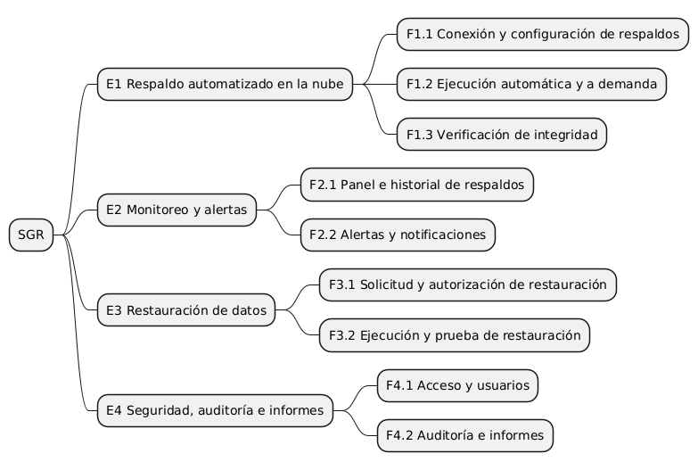

# 01 – Visión del producto y backlog ágil

| | |
|---|---|
| **Entregable** | Punto 1 de la consigna (Parcial 3) |
| **Estado** | Versión final – 30/10/2026 |
| **Sistema** | Sistema de Gestión de Respaldos de Prometva (**SGR**) |
| **Documento base** | [00 – Documento maestro](00-documento-maestro.md) (nombres, reglas y glosario vinculantes) |
| **Fuente del diagrama** | [`01-jerarquia.puml`](../diagramas/01-jerarquia.puml) |

## 1. Visión del producto

Para la Dirección y el personal de Prometva (pyme de ingeniería, fabricación y montaje de estructuras metálicas, de unas 30 personas), que hoy guardan toda su información de gestión en dos servidores físicos privados sin ninguna copia externa, el **Sistema de Gestión de Respaldos (SGR)** es una herramienta que programa, ejecuta, verifica, monitorea y restaura automáticamente las copias de seguridad de las bases de datos de Strumis y Tango en la nube de Acronis, con una pérdida máxima de datos de 10 minutos. A diferencia del esquema actual, en el que una falla o un ataque como el ya sufrido puede dejar a la empresa sin sus datos, el SGR protege la información sin cambiar la forma de trabajar de la empresa y sin exigir un área de informática especializada.

**Origen en el trabajo de OAS:** Mandato (objetivo, alcance y límite) y Solución Elegida (Acronis Cloud, solución 1 del Flujograma de Soluciones).

## 2. Estructura del backlog

- **4 épicas**, **9 features** y **23 historias de usuario**, con un total de **95 story points**.
- Distribución MoSCoW por puntos: Must 63 (66 %), Should 27 (28 %), Could 5 (5 %). El Must supera el 60 % habitual porque el producto es de protección de datos: sin respaldo, verificación, alertas, restauración y auditoría el sistema no cumple su propósito.
- Cada requisito funcional del maestro se corresponde uno a uno con una HU (**RF-nn = HU-0nn**).
- Escala de estimación y capacidad: ver [02 – Plan de sprints](02-plan-de-sprints.md).
- Fuera del alcance (Won't): ver sección 6.

## 3. Épicas, features y trazabilidad con OAS

> La trazabilidad usa las secciones del trabajo de campo de OAS (Mandato, Relevamiento, Estudio Preliminar, Diagnóstico, Solución Elegida, Resultado esperado), según la guía *Mapeo OAS → Scrum* de la cátedra.

| Épica | Objetivo | Features | Sale de (trabajo de OAS) |
|---|---|---|---|
| **E1 Respaldo automatizado en la nube** | Copiar de forma automática y verificada las bases de datos de Strumis y Tango a Acronis Cloud. | F1.1 Conexión y configuración de respaldos F1.2 Ejecución automática y a demanda F1.3 Verificación de integridad | Alcance del mandato (subir los datos del servidor privado a la nube, de forma automatizada, en tiempos muy cortos); Flujograma de Soluciones: Solución 1 (Acronis Cloud → Respaldo Automatizado); Solución Elegida; Backup Empresarial (características técnicas). |
| **E2 Monitoreo y alertas** | Dar visibilidad del estado de los respaldos y avisar a tiempo cuando algo falla o se atrasa. | F2.1 Panel e historial de respaldos F2.2 Alertas y notificaciones | Diagnóstico (garantizar seguridad y confiabilidad ante cualquier situación); Backup Empresarial (gestión centralizada: panel web para monitorear tareas); Resultado esperado. |
| **E3 Restauración de datos** | Poder recuperar los datos de forma controlada tras una falla o un ataque, y comprobar que la recuperación funciona. | F3.1 Solicitud y autorización de restauración F3.2 Ejecución y prueba de restauración | Relevamiento (hackeo del servidor y pago de un monto elevado para recuperar los datos); Estudio Preliminar (percance sufrido); Backup Empresarial (recuperación granular o total). |
| **E4 Seguridad, auditoría e informes** | Controlar quién accede a qué, dejar registro de lo que ocurre y rendir cuentas a Dirección. | F4.1 Acceso y usuarios F4.2 Auditoría e informes | Estudio Preliminar (Tango: acceso solo de la administración y Dirección); Mandato – Límite (no alterar el flujo actual); Resultado esperado (confiabilidad y privacidad); Organigrama (roles). |

## 4. Historias de usuario

Todas con formato *Como / quiero / para*, prioridad MoSCoW y estimación en story points. El detalle completo (Dado/Cuando/Entonces, datos de prueba, etc.) está solo en las 4 HU del punto 8 (carpeta `docs/historias/`); acá cada HU trae un criterio de aceptación resumido y verificable.

### E1 – Respaldo automatizado en la nube

#### F1.1 – Conexión y configuración de respaldos

**HU-001 – Registrar los servidores de origen** · Must · 3 SP · Sprint 1

- Como **Responsable de Respaldos** quiero registrar los servidores de origen (STRUMIS y TANGO), cada uno con su agente de Acronis para que el sistema sepa exactamente qué datos debe proteger.
- **Criterio verificable (resumen):** Se pueden registrar los servidores STRUMIS y TANGO, cada uno con su agente de Acronis ya instalado; no se acepta registrar dos veces la misma clave; cada servidor queda con un único agente asociado.
- **Depende de:** HU-018
- **Origen en OAS:** Relevamiento (dos servidores privados separados: Strumis y Tango); Backup Empresarial (agente en cada servidor).

**HU-002 – Conectar el sistema con Acronis Cloud** · Must · 5 SP · Sprint 2

- Como **Responsable de Respaldos** quiero configurar las credenciales de la cuenta de Acronis Cloud y probar la conexión para que los respaldos puedan enviarse a la nube.
- **Criterio verificable (resumen):** Con credenciales válidas la prueba informa conexión exitosa; con credenciales inválidas informa el error y no guarda la configuración.
- **Depende de:** HU-018
- **Origen en OAS:** Flujograma de Soluciones: Solución 1 (Acronis Cloud); Alcance del mandato (subir los datos a la nube).

**HU-003 – Definir la política de respaldo de cada servidor** · Must · 5 SP · Sprint 1

- Como **Responsable de Respaldos** quiero definir para cada servidor el intervalo de respaldo (entre 5 y 10 minutos, por defecto 5), el esquema de tipos de respaldo y la retención para cumplir el objetivo de perder como máximo 10 minutos de datos.
- **Criterio verificable (resumen):** Un intervalo fuera del rango 5–10 minutos se rechaza con mensaje; el valor por defecto es 5 y, si se elige un intervalo mayor, se avisa que el objetivo de RNF-01 puede no cumplirse; la política guardada se muestra al reabrirla; un servidor sin política queda marcado como sin protección.
- **Depende de:** HU-001
- **Origen en OAS:** Alcance del mandato (tiempo real o tiempos prolongados muy cortos); Solución Elegida (plazo mínimo de guardado entre 5 y 10 minutos).

#### F1.2 – Ejecución automática y a demanda

**HU-004 – Ejecutar respaldos automáticos según la política** · Must · 8 SP · Sprint 2

- Como **Responsable de Respaldos** quiero que los respaldos de STRUMIS y TANGO se ejecuten automáticamente según la política de cada servidor para no depender de copias manuales ni de que alguien se acuerde de hacerlas.
- **Criterio verificable (resumen):** Con una política de 5 minutos, entre dos ejecuciones del mismo servidor pasan 5 minutos ±1; el primer respaldo de cada servidor es COMPLETO y los siguientes INCREMENTAL (cada intervalo) o DIFERENCIAL (uno por día); cada ejecución genera una tarea con estado, tipo y disparador PROGRAMADO; STRUMIS y TANGO se respaldan de forma independiente; si llega un ciclo y el servidor aún tiene un respaldo en curso, ese ciclo se omite y se registra.
- **Depende de:** HU-002, HU-003
- **Origen en OAS:** Alcance del mandato (de forma automatizada); Diagnóstico (que no se tenga que hacer manualmente); Flujograma de Soluciones (Respaldo Automatizado).

**HU-005 – Reintentar automáticamente un respaldo fallido** · Must · 3 SP · Sprint 2

- Como **Responsable de Respaldos** quiero que el sistema reintente hasta 3 veces un respaldo de STRUMIS o TANGO que falló para superar fallas transitorias sin intervención humana.
- **Criterio verificable (resumen):** Si el respaldo falla por un error del propio respaldo, se hacen hasta 3 reintentos separados por 1 minuto; si uno tiene éxito la tarea termina COMPLETADA y no se alerta; si se agotan, la tarea queda FALLIDA; las fallas por falta de conexión no consumen reintentos (ver HU-007).
- **Depende de:** HU-004
- **Origen en OAS:** Diagnóstico (confiabilidad ante cualquier situación que pueda verse afectada).

**HU-006 – Lanzar un respaldo manual a demanda** · Should · 3 SP · Sprint 2

- Como **Responsable de Respaldos** quiero lanzar de inmediato un respaldo de STRUMIS o TANGO para proteger los datos antes de un cambio importante en ese servidor, como una actualización de Strumis o de Tango.
- **Criterio verificable (resumen):** Solo el Responsable puede lanzarlo; si ya hay un respaldo en ejecución del mismo servidor se informa y no se lanza otro; la tarea queda con disparador MANUAL y el usuario queda registrado en la auditoría (HU-023).
- **Depende de:** HU-004, HU-023
- **Origen en OAS:** Backup Empresarial (gestión centralizada: programar backups desde el panel).

**HU-007 – Encolar respaldos cuando no hay conexión a Internet** · Should · 5 SP · Sprint 3

- Como **Responsable de Respaldos** quiero que los respaldos pendientes de STRUMIS y TANGO se conserven cuando se corta Internet y se envíen al recuperarse la conexión para no dejar huecos en la cobertura de datos.
- **Criterio verificable (resumen):** Sin conexión la tarea queda EN_COLA sin consumir reintentos y no se pierde; al volver la conexión se envía en orden cronológico; el panel indica que hay tareas en cola.
- **Depende de:** HU-004
- **Origen en OAS:** Backup Empresarial (requisito: conexión a Internet estable).

#### F1.3 – Verificación de integridad

**HU-008 – Verificar la integridad de cada respaldo** · Must · 5 SP · Sprint 3

- Como **Responsable de Respaldos** quiero que el sistema verifique la integridad de cada respaldo completado pidiendo su validación a Acronis Cloud para tener certeza de que podrá usarse en una restauración.
- **Criterio verificable (resumen):** Cuando Acronis valida el respaldo como íntegro, la tarea pasa de VERIFICANDO a COMPLETADA y se genera un punto de restauración; si Acronis informa un error de integridad, no se genera punto de restauración y la tarea pasa a EN_REINTENTO (HU-005); si se agotan los reintentos, queda FALLIDA.
- **Depende de:** HU-004
- **Origen en OAS:** Diagnóstico (garantizar la seguridad y la confiabilidad de los datos); Resultado esperado.

### E2 – Monitoreo y alertas

#### F2.1 – Panel e historial de respaldos

**HU-009 – Consultar el estado de los respaldos en un panel** · Must · 5 SP · Sprint 4

- Como **Responsable de Respaldos** quiero ver en un panel el estado de los respaldos de STRUMIS y TANGO (último exitoso, próximo programado, tarea en curso y alertas abiertas) para detectar rápido si algo no está funcionando.
- **Criterio verificable (resumen):** El panel muestra por servidor la antigüedad del último respaldo exitoso; se marca en amarillo si supera 10 minutos y en rojo si supera 15; lista las alertas ABIERTAS; se actualiza al menos cada 60 segundos; Dirección ve el mismo panel en solo lectura, sin botones de acción.
- **Depende de:** HU-004
- **Origen en OAS:** Backup Empresarial (gestión centralizada: panel web para monitorear tareas).

**HU-010 – Consultar el historial de respaldos con filtros** · Should · 3 SP · Sprint 4

- Como **Responsable de Respaldos** quiero consultar el historial de respaldos filtrando por servidor (STRUMIS o TANGO), estado y rango de fechas para investigar qué pasó en un momento determinado.
- **Criterio verificable (resumen):** Los filtros combinados devuelven solo las tareas que los cumplen; sin resultados se muestra el mensaje «No hay respaldos para los filtros indicados».
- **Depende de:** HU-004
- **Origen en OAS:** Backup Empresarial (panel web para monitorear tareas).

**HU-022 – Consultar el estado de los respaldos de Tango** · Could · 2 SP · Sprint 6

- Como **Gerente de Administración** quiero consultar en modo solo lectura el estado de los respaldos del servidor TANGO para saber que la información contable y de facturación está protegida.
- **Criterio verificable (resumen):** Solo se ve el servidor TANGO; no hay botones para lanzar respaldos ni restaurar; no se ve información de STRUMIS.
- **Depende de:** HU-009, HU-018
- **Origen en OAS:** Estudio Preliminar (registros contables en Tango, acceso solo de administración y Dirección).

#### F2.2 – Alertas y notificaciones

**HU-011 – Recibir una alerta cuando un respaldo falla** · Must · 5 SP · Sprint 3

- Como **Responsable de Respaldos** quiero recibir una alerta por correo y en el panel cuando un respaldo queda FALLIDA tras agotar los reintentos para actuar antes de que se acumule la pérdida de datos.
- **Criterio verificable (resumen):** La alerta (tipo FALLA, severidad CRITICA) indica servidor, hora y motivo; llega al Responsable por correo y se muestra en el panel en menos de 1 minuto; no se genera si un reintento tuvo éxito; si el correo falla, la alerta queda ABIERTA y visible en el panel; pasa a CERRADA cuando un respaldo posterior del servidor resulta exitoso.
- **Depende de:** HU-005
- **Origen en OAS:** Relevamiento (el incidente sufrido por la empresa); Diagnóstico.

**HU-012 – Recibir una alerta por atraso de respaldos** · Should · 3 SP · Sprint 3

- Como **Responsable de Respaldos** quiero recibir una alerta cuando el último respaldo exitoso de STRUMIS o TANGO supera los 15 minutos para enterarme de que un servidor quedó sin protección aunque no haya un error explícito.
- **Criterio verificable (resumen):** Pasados 15 minutos sin respaldo exitoso se genera una alerta de tipo ATRASO y severidad ADVERTENCIA que indica el servidor afectado; pasados 30 minutos se eleva esa misma alerta a CRITICA (no se crea otra); cuando hay un respaldo exitoso posterior pasa a CERRADA.
- **Depende de:** HU-011
- **Origen en OAS:** Diagnóstico (garantizar confiabilidad ante cualquier situación).

**HU-013 – Notificar a Dirección las alertas críticas** · Should · 2 SP · Sprint 4

- Como **Dirección** quiero recibir las alertas de severidad CRITICA para estar informada de los riesgos sobre los datos de la empresa.
- **Criterio verificable (resumen):** Las alertas CRITICA (de falla o de atraso) llegan a Dirección y al Responsable; las ADVERTENCIA llegan solo al Responsable.
- **Depende de:** HU-011, HU-012
- **Origen en OAS:** Estudio Preliminar (Dirección como máxima responsable de la empresa); Diagnóstico.

### E3 – Restauración de datos

#### F3.1 – Solicitud y autorización de restauración

**HU-014 – Solicitar una restauración** · Must · 5 SP · Sprint 4

- Como **Responsable de Respaldos** quiero solicitar la restauración de STRUMIS o TANGO desde un punto de restauración, de forma total o granular para recuperar los datos tras una falla o un ataque.
- **Criterio verificable (resumen):** Solo se pueden elegir puntos de restauración verificados; el motivo es obligatorio; una restauración GRANULAR exige indicar qué elementos recuperar; la solicitud queda PENDIENTE.
- **Depende de:** HU-008
- **Origen en OAS:** Relevamiento (hackeo y pago para recuperar los datos); Backup Empresarial (restauración granular o total).

**HU-015 – Autorizar o rechazar una solicitud de restauración** · Must · 3 SP · Sprint 4

- Como **Dirección** quiero autorizar o rechazar las solicitudes de restauración para controlar que no se sobrescriban datos de producción sin mi aval.
- **Criterio verificable (resumen):** Solo Dirección puede resolver; al rechazar se exige un motivo; la solicitud pasa a AUTORIZADA o RECHAZADA y se notifica al Responsable; una solicitud ya resuelta no puede resolverse de nuevo.
- **Depende de:** HU-014
- **Origen en OAS:** Estudio Preliminar (datos críticos solo accesibles a Dirección y administración); Resultado esperado (confiabilidad y privacidad).

#### F3.2 – Ejecución y prueba de restauración

**HU-016 – Ejecutar una restauración autorizada** · Must · 8 SP · Sprint 5

- Como **Responsable de Respaldos** quiero ejecutar una restauración autorizada y ver su progreso y resultado para recuperar la operación de la empresa tras una pérdida de datos.
- **Criterio verificable (resumen):** Solo se ejecutan solicitudes AUTORIZADA; antes de sobrescribir producción se ejecuta un respaldo previo a restauración del estado actual (disparador PREVIO_A_RESTAURACION); al terminar la solicitud queda COMPLETADA, o FALLIDA con alerta CRITICA.
- **Depende de:** HU-015
- **Origen en OAS:** Relevamiento (consecuencias de perder los datos); Backup Empresarial (recuperación total o granular desde la nube).

**HU-017 – Realizar un simulacro de restauración** · Should · 5 SP · Sprint 5

- Como **Responsable de Respaldos** quiero ejecutar un simulacro de restauración de STRUMIS o TANGO sobre un destino alternativo, sin tocar producción para comprobar periódicamente que los respaldos realmente permiten recuperar los datos.
- **Criterio verificable (resumen):** El destino alternativo es obligatorio; no se modifica producción; se registra la duración y se compara con el objetivo de 4 horas; el panel avisa si pasaron más de 90 días desde el último simulacro.
- **Depende de:** HU-016
- **Origen en OAS:** Diagnóstico (garantizar seguridad y confiabilidad ante cualquier situación).

### E4 – Seguridad, auditoría e informes

#### F4.1 – Acceso y usuarios

**HU-018 – Autenticarse y acceder según el rol** · Must · 5 SP · Sprint 1

- Como **Usuario del SGR** quiero iniciar sesión con mi usuario y contraseña y ver solo las funciones de mi rol (Responsable de Respaldos, Dirección o Gerente de Administración) para que los datos de respaldo sean accesibles solo para quienes corresponde.
- **Criterio verificable (resumen):** Credenciales inválidas muestran un error genérico que no indica si falló el usuario o la contraseña; 5 intentos fallidos bloquean la cuenta 15 minutos; la contraseña tiene al menos 12 caracteres; tras iniciar sesión solo se muestran las funciones del rol del usuario.
- **Depende de:** —
- **Origen en OAS:** Estudio Preliminar (acceso a Tango restringido); Resultado esperado (privacidad).

**HU-019 – Gestionar usuarios y roles** · Should · 3 SP · Sprint 6

- Como **Dirección** quiero dar de alta, dar de baja y cambiar el rol de los usuarios del sistema para que cada persona tenga solo los permisos que le corresponden.
- **Criterio verificable (resumen):** Se puede crear, desactivar y cambiar el rol de un usuario (Responsable de Respaldos, Dirección o Gerente de Administración); cada usuario tiene un correo electrónico para recibir alertas; no se puede dejar el sistema sin ningún usuario con rol Dirección; la baja es lógica y conserva la auditoría.
- **Depende de:** HU-018, HU-023
- **Origen en OAS:** Organigrama (roles de la empresa); Estudio Preliminar (accesos restringidos).

#### F4.2 – Auditoría e informes

**HU-020 – Consultar el registro de auditoría** · Should · 3 SP · Sprint 5

- Como **Dirección** quiero consultar quién hizo qué y cuándo en el sistema para detectar usos indebidos y reconstruir lo ocurrido ante un incidente.
- **Criterio verificable (resumen):** Cada registro muestra usuario, acción, fecha y hora, y resultado; se puede filtrar por usuario, acción, servidor y fechas; los registros no se pueden modificar ni borrar.
- **Depende de:** HU-023
- **Origen en OAS:** Relevamiento (incidente de seguridad sufrido); Resultado esperado (confiabilidad).

**HU-021 – Generar el informe mensual de respaldos** · Could · 3 SP · Sprint 6

- Como **Dirección** quiero generar un informe mensual del estado de los respaldos de STRUMIS y TANGO para evaluar si la protección de los datos cumple lo esperado.
- **Criterio verificable (resumen):** El informe incluye por servidor el porcentaje de respaldos exitosos, la cantidad de fallos, el mayor tiempo sin respaldo y las restauraciones realizadas; se puede exportar a PDF; un mes sin datos muestra un aviso.
- **Depende de:** HU-010
- **Origen en OAS:** Resultado esperado (aumenta la confiabilidad y la privacidad de los datos).

**HU-023 – Registrar automáticamente las acciones en auditoría** · Must · 3 SP · Sprint 1

- Como **Dirección** quiero que el sistema registre automáticamente cada acción relevante (quién, qué, cuándo y con qué resultado) para poder reconstruir lo ocurrido ante un incidente o un uso indebido.
- **Criterio verificable (resumen):** Cada acción relevante de la lista de RN-13 genera un registro con usuario, fecha y hora, acción y resultado; las acciones automáticas del sistema se registran con el usuario «SGR»; el registro no se puede modificar ni borrar.
- **Depende de:** HU-018
- **Origen en OAS:** Relevamiento (incidente de seguridad sufrido); Resultado esperado (confiabilidad y privacidad).

## 5. Tabla resumen y chequeo INVEST

Convenciones: ✔ cumple; **~** cumple con reservas. **I** y **S** salen de datos (dependencias y puntos: S es «~» con 8 SP); **T** exige un criterio verificable. **N**, **V** y **E** son juicio de los autores: la columna *Observación* justifica lo que no es obvio. El grupo debe revisar esta autoevaluación.

| HU | Título | MoSCoW | SP | Sprint | I | N | V | E | S | T | Observación |
|---|---|---|---|---|---|---|---|---|---|---|---|
| HU-001 | Registrar los servidores de origen | Must | 3 | 1 | ~ | ✔ | ✔ | ✔ | ✔ | ✔ | I: depende de HU-018. S: formulario simple. La instalación del agente en cada servidor es una tarea técnica previa, no una HU. |
| HU-002 | Conectar el sistema con Acronis Cloud | Must | 5 | 2 | ~ | ✔ | ✔ | ✔ | ✔ | ✔ | V: sin conexión no hay respaldo en la nube. E: 5 SP por tratarse de una integración externa (adaptador). |
| HU-003 | Definir la política de respaldo de cada servidor | Must | 5 | 1 | ~ | ✔ | ✔ | ✔ | ✔ | ✔ | N: los valores por defecto son negociables. T: rango y aviso verificables. Elegida para el punto 8. |
| HU-004 | Ejecutar respaldos automáticos según la política | Must | 8 | 2 | ~ | ✔ | ✔ | ✔ | ~ | ✔ | S: 8 SP, en el límite; si en el Sprint 2 se desborda, dividir en (a) planificador y (b) ejecución con estrategias. V: elimina el trabajo manual. Redactada como comportamiento del sistema; el beneficiario es el Responsable. Elegida para el punto 8. |
| HU-005 | Reintentar automáticamente un respaldo fallido | Must | 3 | 2 | ~ | ✔ | ✔ | ✔ | ✔ | ✔ | V: evita alertas por fallas pasajeras. Redactada como comportamiento del sistema. |
| HU-006 | Lanzar un respaldo manual a demanda | Should | 3 | 2 | ~ | ✔ | ✔ | ✔ | ✔ | ✔ | I: depende de HU-004 y HU-023. |
| HU-007 | Encolar respaldos cuando no hay conexión a Internet | Should | 5 | 3 | ~ | ✔ | ✔ | ✔ | ✔ | ✔ | V: evita huecos de cobertura. Redactada como comportamiento del sistema. |
| HU-008 | Verificar la integridad de cada respaldo | Must | 5 | 3 | ~ | ✔ | ✔ | ✔ | ✔ | ✔ | T: depende de la validación que ofrece Acronis (SM-13), a confirmar con la documentación del producto. |
| HU-009 | Consultar el estado de los respaldos en un panel | Must | 5 | 4 | ~ | ✔ | ✔ | ✔ | ✔ | ✔ | N: los umbrales de color son ajustables. Dirección accede en solo lectura (RN-16). |
| HU-010 | Consultar el historial de respaldos con filtros | Should | 3 | 4 | ~ | ✔ | ✔ | ✔ | ✔ | ✔ | S: 3 SP. |
| HU-011 | Recibir una alerta cuando un respaldo falla | Must | 5 | 3 | ~ | ✔ | ✔ | ✔ | ✔ | ✔ | S: 5 SP; el envío a Dirección queda en HU-013 para no mezclar destinatarios. Elegida para el punto 8. |
| HU-012 | Recibir una alerta por atraso de respaldos | Should | 3 | 3 | ~ | ✔ | ✔ | ✔ | ✔ | ✔ | N: los umbrales 15/30 min son negociables (RN-08). |
| HU-013 | Notificar a Dirección las alertas críticas | Should | 2 | 4 | ~ | ✔ | ✔ | ✔ | ✔ | ✔ | I: depende de HU-011 y HU-012. V: implementa RN-09, por eso es Should. |
| HU-014 | Solicitar una restauración | Must | 5 | 4 | ~ | ✔ | ✔ | ✔ | ✔ | ✔ | Elegida para el punto 8. |
| HU-015 | Autorizar o rechazar una solicitud de restauración | Must | 3 | 4 | ~ | ✔ | ✔ | ✔ | ✔ | ✔ | V: control de Dirección sobre la restauración (RN-10). |
| HU-016 | Ejecutar una restauración autorizada | Must | 8 | 5 | ~ | ✔ | ✔ | ✔ | ~ | ✔ | S: 8 SP, en el límite; candidata a dividir (respaldo previo / restauración). I: cadena HU-014 → HU-015 → HU-016. |
| HU-017 | Realizar un simulacro de restauración | Should | 5 | 5 | ~ | ✔ | ✔ | ✔ | ✔ | ✔ | I: depende de HU-016; reutiliza la restauración, pero sin autorización y sin tocar producción. |
| HU-018 | Autenticarse y acceder según el rol | Must | 5 | 1 | ✔ | ✔ | ✔ | ✔ | ✔ | ✔ | S: 5 SP; solo login, bloqueo y vista por rol (los permisos finos están en cada HU). Rol: actor general que agrupa a los tres roles. |
| HU-019 | Gestionar usuarios y roles | Should | 3 | 6 | ~ | ✔ | ✔ | ✔ | ✔ | ✔ | I: depende de HU-018 y HU-023. |
| HU-020 | Consultar el registro de auditoría | Should | 3 | 5 | ~ | ✔ | ✔ | ✔ | ✔ | ✔ | I: depende de HU-023 (que genera los registros); esta HU solo los consulta. |
| HU-021 | Generar el informe mensual de respaldos | Could | 3 | 6 | ~ | ✔ | ✔ | ✔ | ✔ | ✔ | V: rendición de cuentas a Dirección; es Could. |
| HU-022 | Consultar el estado de los respaldos de Tango | Could | 2 | 6 | ~ | ✔ | ✔ | ✔ | ✔ | ✔ | V: cubre al Gerente de Administración, responsable de los datos de Tango; es Could. |
| HU-023 | Registrar automáticamente las acciones en auditoría | Must | 3 | 1 | ~ | ✔ | ✔ | ✔ | ✔ | ✔ | V: sustenta RN-13 y RNF-06. Es transversal: no tiene pantalla propia, sus registros se ven en HU-020. |

Las dependencias (**I = ~**) son inevitables en un flujo de respaldo → restauración y se resuelven ordenando los sprints. Todas las HU tienen un rol del caso Prometva; las que describen comportamiento automático («quiero que el sistema…») se mantienen así porque el valor lo percibe el Responsable de Respaldos o Dirección.

## 6. Fuera del alcance (Won't) y tareas técnicas previas

- Reemplazar o modificar Strumis, Tango o Sipe 3D, ni el flujo de procesos de la empresa (Límite del mandato).
- Desarrollar un software propio de respaldo o implantar un NAS: son las soluciones 2 y 3 del trabajo de OAS, descartadas (alternativas del ADR-001).
- Respaldar archivos que no sean las bases de datos de Strumis y Tango (por ejemplo, planos de Sipe 3D o documentos sueltos).
- Respaldo continuo en milisegundos: el objetivo es un intervalo de 5 a 10 minutos.
- **Tarea técnica previa (no es una HU):** instalar el agente de Acronis en cada uno de los dos servidores; es precondición de HU-001.

## 7. Definiciones de equipo

**Definition of Ready (DoR):** la HU tiene rol, acción y beneficio; criterios de aceptación verificables; estimación; dependencias identificadas y ya resueltas o planificadas antes; prioridad MoSCoW; y no contradice ninguna regla del documento maestro.

**Definition of Done (DoD):** cumple todos los criterios de aceptación; tiene casos de prueba ejecutados y aprobados; respeta los RNF aplicables; la acción relevante queda en el registro de auditoría (HU-023); el código está revisado por un par; y la documentación afectada está actualizada.

## 8. Historias elegidas para el punto 8

HU-003, HU-004, HU-011 y HU-014 son las cuatro historias que se desarrollan en detalle: cubren configuración, ejecución automática (donde viven los patrones Singleton, Multiton, Strategy y Adapter), alertas y restauración, y todas tienen pantallas. Cada una tiene su archivo en `docs/historias/`, sus casos de prueba en `docs/testing/` y sus pantallas en `prototipo/` (ver el [documento 10](10-prototipo-y-heuristicas.md)). La HU-004 es la que modela el diagrama de secuencia del [documento 07](07-estados-y-secuencia.md).
