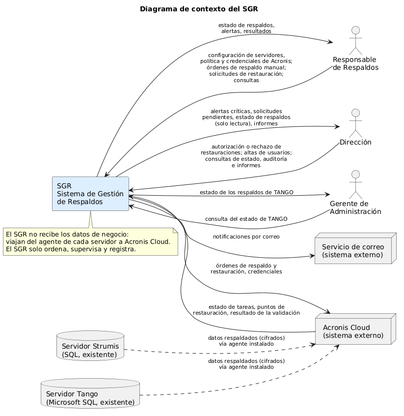
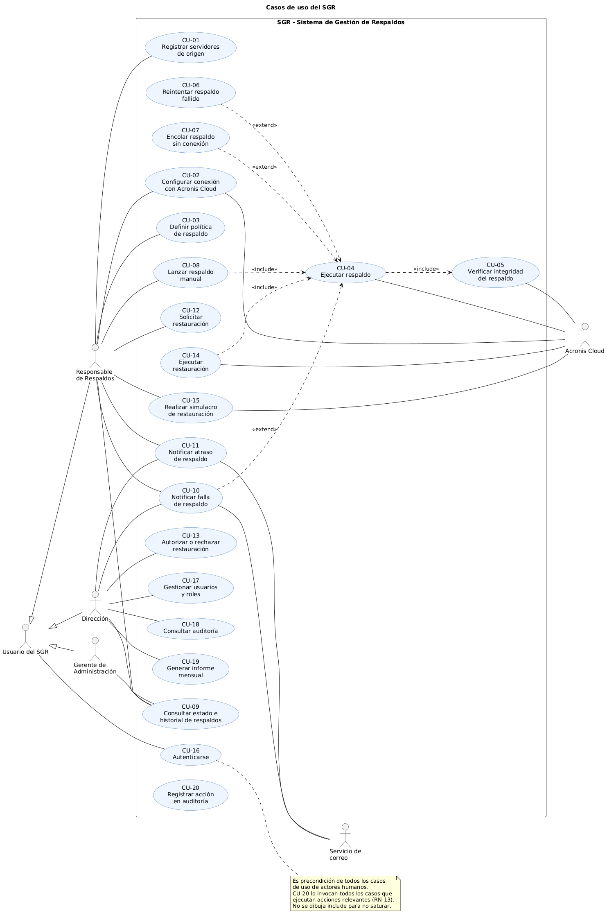

# 03 – Diagrama de contexto y casos de uso

| | |
|---|---|
| **Entregable** | Punto 3 de la consigna (Parcial 2) |
| **Estado** | Versión final – 30/10/2026 |
| **Base** | [00 – Documento maestro](00-documento-maestro.md) (actores, reglas y nombres) y [01 – Backlog](01-vision-y-backlog.md) (historias de usuario) |
| **Fuentes de los diagramas** | [`03-contexto.puml`](../diagramas/03-contexto.puml) y [`03-casos-de-uso.puml`](../diagramas/03-casos-de-uso.puml) |

---

## 1. Diagrama de contexto

El **SGR** se muestra como una caja negra. Alrededor están todos los actores humanos y los sistemas externos, con la información que entra y sale.

### Flujos de información

| Desde | Hacia | Información |
|---|---|---|
| Responsable de Respaldos | SGR | Configuración de servidores, política de respaldo y credenciales de Acronis; órdenes de respaldo manual; solicitudes de restauración; consultas. |
| SGR | Responsable de Respaldos | Estado de los respaldos, alertas y resultados de tareas. |
| Dirección | SGR | Autorización o rechazo de restauraciones; altas, bajas y cambios de rol de usuarios; consultas de estado, de auditoría y de informes. |
| SGR | Dirección | Alertas críticas, solicitudes de restauración pendientes, estado de los respaldos (solo lectura) e informes. |
| Gerente de Administración | SGR | Consulta del estado de TANGO. |
| SGR | Gerente de Administración | Estado de los respaldos de TANGO (solo lectura). |
| SGR | Acronis Cloud | Órdenes de respaldo y restauración; credenciales. |
| Acronis Cloud | SGR | Estado de las tareas, puntos de restauración disponibles, resultado de la validación del respaldo. |
| SGR | Servicio de correo | Notificaciones por correo electrónico. |
| Servidor Strumis / Servidor Tango | Acronis Cloud | Datos respaldados y cifrados, enviados por el agente instalado en cada servidor (línea punteada). |

### Decisión de modelado: los datos no pasan por el SGR

Los servidores de Strumis y Tango **no se comunican con el SGR**: el SGR le ordena a Acronis Cloud, y el agente de Acronis instalado en cada servidor envía los datos directamente a la nube. Se dibujan en el contexto porque son el origen de los datos protegidos, pero la flecha va hacia Acronis. Esto reduce el impacto sobre producción (RN-01, RNF-04) y evita que el SGR maneje datos de negocio (RNF-02).

## 2. Actores

| Actor | Tipo | Participa en |
|---|---|---|
| **Usuario del SGR** | Actor general (los tres roles heredan de él) | CU-16 |
| **Responsable de Respaldos** | Humano (rol a designar por Dirección, **SM-02**) | CU-01, 02, 03, 08, 09, 10, 11, 12, 14, 15 (y CU-16 como Usuario del SGR) |
| **Dirección** | Humano | CU-09 (solo lectura), 10, 11, 13, 17, 18, 19 (y CU-16) |
| **Gerente de Administración** | Humano | CU-09 (solo TANGO, lectura) (y CU-16) |
| **Acronis Cloud** | Sistema externo (secundario) | CU-02, 04, 05, 14, 15 |
| **Servicio de correo** | Sistema externo (secundario) | CU-10, 11 |

Los servidores Strumis y Tango no aparecen como actores de los casos de uso porque, por la decisión de arriba, no interactúan directamente con el SGR. Los casos **CU-04**, **CU-11** y **CU-20** no tienen un actor humano que los inicie: los dispara el propio SGR (el `PlanificadorDeRespaldos`, el monitoreo de atrasos y cada acción relevante).

## 3. Diagrama de casos de uso

### 3.1 Catálogo de casos de uso

| ID | Caso de uso | Actor principal | Actores secundarios | Descripción breve | Reglas |
|---|---|---|---|---|---|
| CU-01 | Registrar servidores de origen | Responsable de Respaldos | — | Registra los servidores `STRUMIS` y `TANGO` con su agente de respaldo (el agente de Acronis ya está instalado en cada uno). | RN-02 |
| CU-02 | Configurar conexión con Acronis Cloud | Responsable de Respaldos | Acronis Cloud | Ingresa las credenciales de Acronis y prueba la conexión. | RN-15 |
| CU-03 | Definir política de respaldo | Responsable de Respaldos | — | Define intervalo (5 a 10 min, por defecto 5), esquema de tipos y retención de un servidor. | RN-03, RN-04, RN-12 |
| CU-04 | Ejecutar respaldo | SGR (Planificador) | Acronis Cloud | Lanza el respaldo de un servidor según su política (disparador `PROGRAMADO`) y registra la tarea. | RN-01, RN-04, RN-05, RN-07, RN-15 |
| CU-05 | Verificar integridad del respaldo | SGR | Acronis Cloud | Pide a Acronis la validación del respaldo y lo da por completado solo si resulta íntegro. | RN-07 |
| CU-06 | Reintentar respaldo fallido | SGR | — | Repite hasta 3 veces, cada 1 minuto, un respaldo que falló por un error propio del respaldo. | RN-06 |
| CU-07 | Encolar respaldo sin conexión | SGR | — | Retiene la tarea en `EN_COLA`, sin consumir reintentos, cuando no hay Internet y la envía al volver la conexión. | RN-17 |
| CU-08 | Lanzar respaldo manual | Responsable de Respaldos | — | Pide un respaldo inmediato de un servidor (disparador `MANUAL`). | RN-05 |
| CU-09 | Consultar estado e historial de respaldos | Responsable de Respaldos; Dirección; Gerente de Administración | — | Panel con último respaldo, próximo, tarea en curso y alertas abiertas, e historial con filtros. Dirección lo ve en solo lectura; el Gerente solo ve TANGO y sin acciones. | RN-16 |
| CU-10 | Notificar falla de respaldo | SGR | Servicio de correo | Genera y envía la alerta (tipo `FALLA`) cuando un respaldo queda `FALLIDA`. Receptores: Responsable de Respaldos y Dirección. | RN-06, RN-08, RN-09 |
| CU-11 | Notificar atraso de respaldo | SGR | Servicio de correo | Genera la alerta de tipo `ATRASO`: `ADVERTENCIA` (más de 15 min) o `CRITICA` (más de 30 min) sin respaldo exitoso. Receptores: Responsable de Respaldos y, si es `CRITICA`, Dirección. | RN-08, RN-09 |
| CU-12 | Solicitar restauración | Responsable de Respaldos | — | Pide restaurar un servidor desde un punto de restauración, total o granular, con motivo. | RN-10 |
| CU-13 | Autorizar o rechazar restauración | Dirección | — | Resuelve una solicitud pendiente; rechazar exige motivo. | RN-10 |
| CU-14 | Ejecutar restauración | Responsable de Respaldos | Acronis Cloud | Ejecuta una restauración ya autorizada, precedida de un respaldo previo a restauración, y muestra su avance y resultado. | RN-10, RN-11 |
| CU-15 | Realizar simulacro de restauración | Responsable de Respaldos | Acronis Cloud | Restaura sobre un destino alternativo para comprobar que la recuperación funciona. | RN-14 |
| CU-16 | Autenticarse | Usuario del SGR | — | Inicia sesión con usuario y contraseña y accede a las funciones de su rol. | RN-16, RN-18 |
| CU-17 | Gestionar usuarios y roles | Dirección | — | Alta, baja y cambio de rol de usuarios. | RN-16, RN-18 |
| CU-18 | Consultar auditoría | Dirección | — | Consulta el registro de acciones, con filtros. | RN-13 |
| CU-19 | Generar informe mensual | Dirección | — | Genera y exporta el informe mensual del estado de los respaldos. | — |
| CU-20 | Registrar acción en auditoría | SGR | — | Crea un registro inmutable (usuario, fecha y hora, acción y resultado) cada vez que ocurre una acción relevante. | RN-13 |

**CU-20 es transversal:** lo invocan todos los casos de uso que ejecutan acciones relevantes (la lista está en RN-13). No se dibuja como `include` desde cada caso para no saturar el diagrama; CU-18 solo *consulta* lo que CU-20 registra.

### 3.2 Relaciones `include` y `extend`

| Relación | Caso base | Caso relacionado | Por qué corresponde |
|---|---|---|---|
| `include` | CU-04 Ejecutar respaldo | CU-05 Verificar integridad | **Todo** respaldo se verifica antes de darse por completado (RN-07); es una parte obligatoria y reutilizable del flujo. |
| `include` | CU-08 Lanzar respaldo manual | CU-04 Ejecutar respaldo | El respaldo manual ejecuta exactamente el mismo comportamiento que el programado, solo cambia quién lo dispara. |
| `include` | CU-14 Ejecutar restauración | CU-04 Ejecutar respaldo | Antes de restaurar sobre producción siempre se hace un respaldo previo a restauración (RN-11), que es una ejecución de CU-04 con disparador `PREVIO_A_RESTAURACION`. |
| `extend` | CU-04 Ejecutar respaldo | CU-06 Reintentar respaldo fallido | Solo ocurre **si** el respaldo falla por un error propio y quedan reintentos. Punto de extensión: *respaldo con error*. |
| `extend` | CU-04 Ejecutar respaldo | CU-07 Encolar respaldo sin conexión | Solo ocurre **si** no hay conexión a Internet. Punto de extensión: *envío a la nube*. |
| `extend` | CU-04 Ejecutar respaldo | CU-10 Notificar falla de respaldo | Solo ocurre **si** la tarea queda `FALLIDA` tras agotar los reintentos. Punto de extensión: *respaldo fallido*. |

**Relaciones consideradas y descartadas por forzadas:**
- *CU-16 Autenticarse* no se conecta con `include` a todos los casos: sería correcto pero ensucia el diagrama; se declara como precondición común y se modela con el actor general **Usuario del SGR**.
- *CU-15 Simulacro* no incluye a *CU-14 Ejecutar restauración*: comparten operaciones, pero el simulacro no requiere autorización y nunca toca producción, así que son casos distintos.
- *CU-11 Notificar atraso* no extiende a CU-04: el atraso se detecta justamente cuando **no** hay un respaldo en curso, por lo que es un caso independiente disparado por el monitoreo.

### 3.3 Precondiciones y resultados

| ID | Precondición | Resultado (postcondición) |
|---|---|---|
| CU-01 | Usuario autenticado como Responsable; agente de Acronis instalado en el servidor. | El servidor queda registrado con un único agente. |
| CU-02 | Usuario autenticado como Responsable. | Conexión validada y guardada; si falla, no se guarda nada y se informa el error. |
| CU-03 | Servidor registrado (CU-01). | Política vigente para el servidor. |
| CU-04 | Servidor registrado, política definida y conexión configurada. | `TareaDeRespaldo` en `COMPLETADA`, `FALLIDA` o `EN_COLA`; queda en el historial. |
| CU-05 | Respaldo enviado a la nube. | La tarea pasa a `COMPLETADA` y se genera un `PuntoDeRestauracion`, o pasa a `EN_REINTENTO` (y a `FALLIDA` si se agotan los reintentos), sin generar punto de restauración. |
| CU-08 | Responsable autenticado; no hay otro respaldo en curso del mismo servidor. | Respaldo ejecutado; queda el usuario en la auditoría. |
| CU-09 | Usuario autenticado. | Estado mostrado según el rol (Dirección, solo lectura; el Gerente ve solo TANGO). |
| CU-10 / CU-11 | Condición de falla o atraso detectada. | `Alerta` creada, notificada y visible en el panel. |
| CU-12 | Existe al menos un `PuntoDeRestauracion` verificado. | `SolicitudDeRestauracion` en `PENDIENTE`. |
| CU-13 | Solicitud en `PENDIENTE`. | Solicitud en `AUTORIZADA` o `RECHAZADA`; se notifica al Responsable. |
| CU-14 | Solicitud en `AUTORIZADA`. | Datos restaurados y solicitud `COMPLETADA`; o `FALLIDA` con alerta `CRITICA`. |
| CU-15 | Destino alternativo disponible. | Duración registrada y comparada con el objetivo de 4 horas (RNF-05). |
| CU-20 | Ocurre una acción relevante (RN-13). | Registro creado con usuario (o «SGR»), fecha y hora, acción y resultado; no se puede modificar ni borrar. |

## 4. Trazabilidad caso de uso ↔ historias de usuario

### 4.1 Por caso de uso

| Caso de uso | Historias de usuario que lo implementan |
|---|---|
| CU-01 Registrar servidores de origen | HU-001 |
| CU-02 Configurar conexión con Acronis Cloud | HU-002 |
| CU-03 Definir política de respaldo | HU-003 |
| CU-04 Ejecutar respaldo | HU-004 |
| CU-05 Verificar integridad del respaldo | HU-008 |
| CU-06 Reintentar respaldo fallido | HU-005 |
| CU-07 Encolar respaldo sin conexión | HU-007 |
| CU-08 Lanzar respaldo manual | HU-006 |
| CU-09 Consultar estado e historial de respaldos | HU-009, HU-010, HU-022 |
| CU-10 Notificar falla de respaldo | HU-011, HU-013 |
| CU-11 Notificar atraso de respaldo | HU-012, HU-013 |
| CU-12 Solicitar restauración | HU-014 |
| CU-13 Autorizar o rechazar restauración | HU-015 |
| CU-14 Ejecutar restauración | HU-016 |
| CU-15 Realizar simulacro de restauración | HU-017 |
| CU-16 Autenticarse | HU-018 |
| CU-17 Gestionar usuarios y roles | HU-019 |
| CU-18 Consultar auditoría | HU-020 |
| CU-19 Generar informe mensual | HU-021 |
| CU-20 Registrar acción en auditoría | HU-023 |

### 4.2 Por historia de usuario

| HU | Caso(s) de uso | HU | Caso(s) de uso |
|---|---|---|---|
| HU-001 | CU-01 | HU-013 | CU-10, CU-11 |
| HU-002 | CU-02 | HU-014 | CU-12 |
| HU-003 | CU-03 | HU-015 | CU-13 |
| HU-004 | CU-04 | HU-016 | CU-14 |
| HU-005 | CU-06 | HU-017 | CU-15 |
| HU-006 | CU-08 | HU-018 | CU-16 |
| HU-007 | CU-07 | HU-019 | CU-17 |
| HU-008 | CU-05 | HU-020 | CU-18 |
| HU-009 | CU-09 | HU-021 | CU-19 |
| HU-010 | CU-09 | HU-022 | CU-09 |
| HU-011 | CU-10 | HU-023 | CU-20 |
| HU-012 | CU-11 | | |

Las 23 historias del backlog están cubiertas y los 20 casos de uso tienen al menos una historia.
