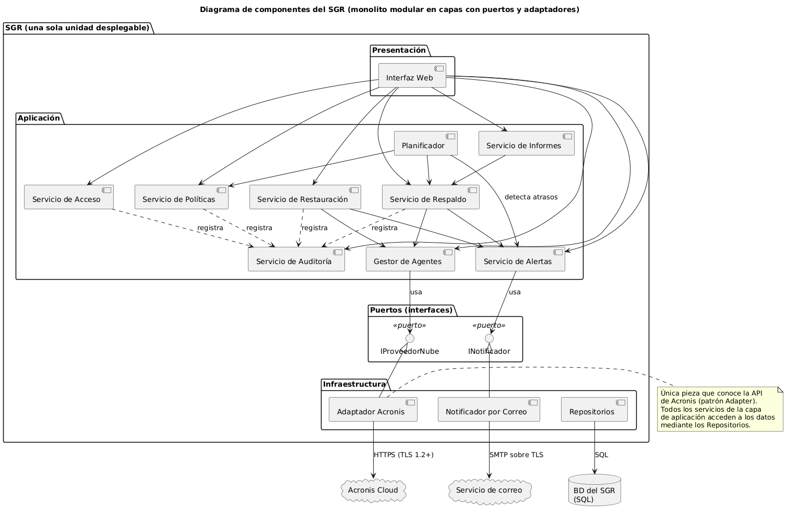
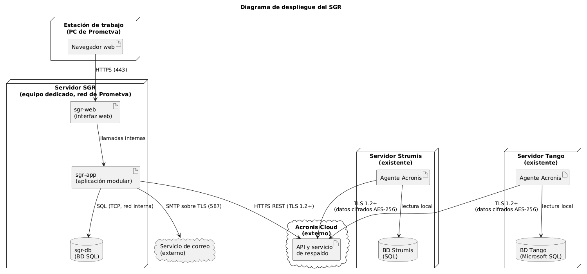

# 04 – Requerimientos no funcionales y arquitectura

| | |
|---|---|
| **Entregable** | Punto 4 de la consigna (Parcial 2) |
| **Estado** | Borrador v2 – 24/10/2026 |
| **Base** | [00 – Documento maestro](00-documento-maestro.md), [03 – Contexto y casos de uso](03-contexto-y-casos-de-uso.md) |
| **Fuentes de los diagramas** | [`04-componentes.puml`](../diagramas/04-componentes.puml) y [`04-despliegue.puml`](../diagramas/04-despliegue.puml) |
| **Decisiones registradas** | [ADR-001](adr/ADR-001-proveedor-de-respaldo-acronis.md), [ADR-002](adr/ADR-002-estilo-monolito-modular.md), [ADR-003](adr/ADR-003-servidor-dedicado-para-el-sgr.md) |

> Los valores numéricos que no figuran en el trabajo de campo de OAS (volumen, ancho de banda, disponibilidad, tiempos) son **supuestos [A VALIDAR]** con la empresa; están justificados en el documento maestro (SM-08 y siguientes).

---

## 1. Requerimientos no funcionales

Cada RNF indica el atributo de calidad, el escenario (quién hace qué, en qué condiciones, qué debe pasar) y una **métrica medible**. Los identificadores y las métricas son los mismos que en el documento maestro.

| ID | Atributo | Escenario | Métrica | Cómo se mide |
|---|---|---|---|---|
| **RNF-01** | Confiabilidad (pérdida máxima de datos, RPO) | Con ambos servidores en operación normal y la política por defecto (5 minutos), cada vez que se cumple el intervalo el SGR obtiene un respaldo verificado de cada servidor. | Con el intervalo por defecto (5 minutos), en el 99 % de las mediciones realizadas durante 30 días, la antigüedad del último respaldo exitoso de cada servidor es ≤ 10 minutos. | El SGR registra cada minuto la antigüedad del último respaldo exitoso y calcula el porcentaje en ventanas de 30 días. La antigüedad es el intervalo más la duración del respaldo y de su verificación; por eso el intervalo por defecto es 5 y no 10. |
| **RNF-02** | Seguridad (cifrado) | Cuando un agente envía datos a Acronis Cloud o el SGR se comunica con ella, la información debe viajar y quedar guardada cifrada. | El 100 % de los respaldos se cifra con AES-256 en reposo y viaja por TLS 1.2 o superior; 0 transferencias sin cifrar. | Se verifica que todos los planes de respaldo tengan el cifrado activado y que el SGR rechace conexiones con TLS inferior a 1.2. El cifrado en reposo no se puede medir desde el SGR: se respalda con la documentación y las certificaciones del proveedor. |
| **RNF-03** | Disponibilidad del SGR | Durante el mes, los usuarios acceden al SGR y el Planificador sigue disparando respaldos. | Disponibilidad mensual ≥ 99 % (hasta 7,2 horas de caída por mes de 30 días). | Monitoreo del servicio (consulta periódica de estado) y registro de reinicios. |
| **RNF-04** | Rendimiento (impacto sobre producción) | Con 30 usuarios concurrentes trabajando en Strumis, se ejecuta un respaldo en el servidor. | Con 30 usuarios concurrentes en Strumis, el tiempo de respuesta durante un respaldo no empeora más de un 10 % respecto de la medición sin respaldo. | Prueba de carga con y sin respaldo en curso, comparando el percentil 95 del tiempo de respuesta. |
| **RNF-05** | Recuperabilidad (RTO) | Tras una falla o ataque y con la restauración ya autorizada, el Responsable restaura un servidor completo desde la nube. | Una restauración total de un servidor (hasta 100 GB) se completa en ≤ 4 horas desde su autorización. | Cronometrado en cada simulacro (HU-017); el SGR registra la duración. |
| **RNF-06** | Auditabilidad | Dirección investiga qué ocurrió en una fecha determinada. | El 100 % de las acciones relevantes (lista en RN-13) queda registrado (usuario, fecha y hora, resultado) y se consulta en ≤ 3 segundos sobre 12 meses de registros. | Prueba de cobertura (cada acción de la lista de RN-13 genera un registro) y prueba de rendimiento de la consulta sobre datos de 12 meses. |
| **RNF-07** | Usabilidad | Un Responsable de Respaldos sin conocimientos técnicos avanzados define una política de respaldo. | El 90 % de al menos 5 usuarios de prueba define una política de respaldo en ≤ 3 minutos y sin ayuda. | Prueba con al menos 5 usuarios, cronometrando la tarea. |
| **RNF-08** | Compatibilidad | El SGR respalda las bases ya existentes de Strumis (SQL) y de Tango (Microsoft SQL) sin modificarlas. | Después de restaurar en un destino alternativo, el 100 % de las tablas de la base de Strumis y de la de Tango coincide con la original en cantidad de registros y suma de control, y el respaldo no modifica las bases originales. | Respaldo y restauración en un destino alternativo de una copia de cada base, comparando cantidad de registros y suma de control por tabla (mediante un simulacro, HU-017). |

## 2. Estilo arquitectónico elegido

**Estilo: monolito modular en capas, con puertos y adaptadores hacia los sistemas externos** (una variante ligera de arquitectura hexagonal), accedido por los usuarios mediante una interfaz web (cliente-servidor).

La decisión completa, con alternativas, está en [ADR-002](adr/ADR-002-estilo-monolito-modular.md). Se argumenta desde los RNF y las restricciones:

| Razón | RNF o restricción que la sostiene |
|---|---|
| **Una sola unidad desplegable y pocas piezas que operar.** Prometva no tiene área de informática ni quiere tenerla; cada servicio adicional es algo más que mantener. | RE-05; RNF-03 (menos componentes, menos puntos de falla) |
| **El planificador vive dentro de la aplicación, con el estado de las tareas guardado en la base de datos.** Si el servicio se reinicia, retoma lo pendiente sin coordinación distribuida. | RNF-01, RNF-03 |
| **Acronis se accede solo mediante un puerto (`IProveedorNube`) y un adaptador.** Cambiar de proveedor o ajustar la API afecta a una sola pieza. | RNF-02 (seguridad concentrada en un punto), RNF-08 |
| **Los datos de negocio no pasan por el SGR**: viajan del agente a Acronis. El SGR solo orquesta, y el trabajo pesado lo hace el agente en cada servidor. | RNF-04, RNF-02 |
| **Auditoría como servicio único y transversal** invocado por todos los servicios de la aplicación. | RNF-06 |
| **Interfaz web simple, con valores por defecto**, para un usuario no técnico. | RNF-07 |
| **Restauración coordinada por el SGR pero ejecutada por Acronis**, con duración medida en cada simulacro. | RNF-05 |

Con 30 personas en la empresa, 3 roles de usuario y 2 servidores a respaldar, la carga del SGR es baja; la complejidad de microservicios o de una arquitectura de eventos no aporta a ningún RNF y empeora RE-05. Esa comparación está desarrollada en el ADR-002.

## 3. Vista de componentes

### 3.1 Componentes y qué hacen

| Componente | Capa | Responsabilidad | Clases canónicas (documento 06) | Historias |
|---|---|---|---|---|
| Interfaz Web | Presentación | Pantallas de todos los roles. | — | todas |
| Servicio de Acceso | Aplicación | Autenticación, roles y permisos. | `Usuario`, `Rol` | HU-018, HU-019 |
| Servicio de Políticas | Aplicación | Define y valida las políticas de respaldo. | `PoliticaDeRespaldo` | HU-003 |
| Gestor de Agentes | Aplicación | Registra servidores, mantiene un agente por servidor y prueba la conexión con la nube. | `ServidorOrigen`, `AgenteDeRespaldo` | HU-001, HU-002 |
| Planificador | Aplicación | Dispara los respaldos según las políticas y detecta atrasos. | `PlanificadorDeRespaldos` | HU-004, HU-012 |
| Servicio de Respaldo | Aplicación | Crea y controla las tareas, reintentos, cola, verificación e historial. | `TareaDeRespaldo`, `IEstrategiaDeRespaldo`, `RespaldoCompleto`, `RespaldoIncremental`, `RespaldoDiferencial`, `ResultadoDeRespaldo`, `PuntoDeRestauracion` | HU-004 a HU-010, HU-022 |
| Servicio de Alertas | Aplicación | Genera alertas por falla o atraso y las notifica. | `GestorDeAlertas`, `Alerta` | HU-011, HU-012, HU-013 |
| Servicio de Restauración | Aplicación | Solicitud, autorización, ejecución y simulacro de restauraciones. | `ServicioDeRestauracion`, `SolicitudDeRestauracion` | HU-014 a HU-017 |
| Servicio de Auditoría | Aplicación | Registra (HU-023) y consulta (HU-020) las acciones. | `ServicioDeAuditoria`, `RegistroDeAuditoria` | HU-020, HU-023 |
| Servicio de Informes | Aplicación | Genera el informe mensual. | `InformeMensual` | HU-021 |
| `IProveedorNube` / Adaptador Acronis | Puerto / Infraestructura | Habla con la API de Acronis Cloud. | `IProveedorNube`, `AcronisCloudAdapter`, `ApiAcronis`, `SinConexionException` | HU-002, HU-004, HU-016 |
| `INotificador` / Notificador por Correo | Puerto / Infraestructura | Envía correos. | `INotificador`, `NotificadorPorCorreo` | HU-011, HU-013 |
| Repositorios | Infraestructura | Acceso a la base de datos del SGR. | — | todas |

## 4. Vista de despliegue

| Nodo | Artefactos | Comentario |
|---|---|---|
| Estación de trabajo (PC de Prometva) | Navegador web | Desde acá usan el SGR los tres roles. |
| **Servidor SGR** (equipo dedicado nuevo, en la red de Prometva) | `sgr-web`, `sgr-app`, `sgr-db` (base de datos SQL) | Decisión en [ADR-003](adr/ADR-003-servidor-dedicado-para-el-sgr.md). Separado de los servidores de producción. |
| Servidor Strumis (existente) | Agente Acronis, BD de Strumis (SQL) | No se altera su software ni sus procesos; solo se agrega el agente de Acronis (RE-01, RE-06). |
| Servidor Tango (existente) | Agente Acronis, BD de Tango (Microsoft SQL) | Ídem. |
| Acronis Cloud (externo) | API y servicio de respaldo | Almacena los respaldos. |
| Servicio de correo (externo) | — | Recibe las notificaciones del SGR. |

| Enlace | Protocolo | Seguridad |
|---|---|---|
| Navegador → `sgr-web` | HTTPS (puerto 443) | TLS (RNF-02) |
| `sgr-web` → `sgr-app` | Llamadas internas del mismo equipo | — |
| `sgr-app` → `sgr-db` | SQL sobre TCP, red interna | Acceso solo desde el Servidor SGR |
| `sgr-app` → API de Acronis | HTTPS REST | TLS 1.2 o superior (RNF-02) |
| `sgr-app` → Servicio de correo | SMTP sobre TLS (puerto 587) | Cifrado en tránsito |
| Agente Acronis → Acronis Cloud | TLS 1.2 o superior | Datos cifrados con AES-256 (RNF-02) |

## 5. Matriz RNF ↔ decisiones de arquitectura

| RNF | Componentes y decisiones que lo satisfacen | ADR |
|---|---|---|
| RNF-01 | Planificador persistente; reintentos (RN-06); detección de atrasos y alertas; intervalo por defecto de 5 minutos (hasta 10) con respaldos incrementales de pocos datos. | ADR-001, ADR-002 |
| RNF-02 | Cifrado de Acronis (AES-256 y TLS); datos que no pasan por el SGR; HTTPS en la interfaz; un único adaptador hacia el exterior. | ADR-001, ADR-002 |
| RNF-03 | Monolito modular de un solo servicio; estado de tareas persistido; reinicio automático; servidor dedicado. | ADR-002, ADR-003 |
| RNF-04 | Respaldo ejecutado por el agente y no por el SGR; incrementales frecuentes (pocos datos), diferenciales y completo inicial fuera del horario laboral; SGR separado de producción. | ADR-001, ADR-003 |
| RNF-05 | Restauración ejecutada por Acronis; simulacros periódicos que miden el tiempo; enlace de al menos 100 Mbps de bajada. | ADR-001 |
| RNF-06 | Servicio de Auditoría transversal (HU-023) y registros inmutables, con índices por fecha, usuario y acción. | ADR-002 |
| RNF-07 | Interfaz web simple, con valores por defecto (intervalo de 10 minutos) y mensajes claros. | ADR-001, ADR-002 |
| RNF-08 | El respaldo lo hace el agente de Acronis sobre las bases SQL sin modificarlas; se comprueba con simulacros. | ADR-001 |

## 6. Riesgos y límites de esta arquitectura

1. **Dependencia del Planificador.** Si el servicio del SGR está caído, no se lanzan nuevos respaldos, lo que afecta a RNF-01. Se mitiga con reinicio automático, estado persistido y alerta por atraso. Una mejora posible (**[A VALIDAR]**) es registrar también el plan en Acronis para que los agentes sigan por su cuenta.
2. **La base de datos del SGR no se respalda a sí misma.** Por RN-02 hay solo dos orígenes. Si se pierde `sgr-db`, se pierden la auditoría y la configuración. Se declara como límite del modelo y como decisión a validar: sumar `sgr-db` como tercer origen modificaría RN-02.
3. **Dependencia de la conexión a Internet.** Tanto el envío (RNF-01) como la restauración (RNF-05) dependen del ancho de banda supuesto en **SM-08**. Si el enlace real es menor, el RTO de 4 horas no se cumple.
4. **Dependencia de un proveedor externo.** Se acepta en el ADR-001 y se acota con el puerto `IProveedorNube`.
5. **El volumen de 100 GB por servidor es un supuesto.** Si es mayor, deben revisarse RNF-04 y RNF-05.
6. **Completos periódicos.** Si Acronis exigiera respaldos completos periódicos, estos bloquearían los incrementales (RN-05) y habría que revisar RNF-01 (ver SM-04).
