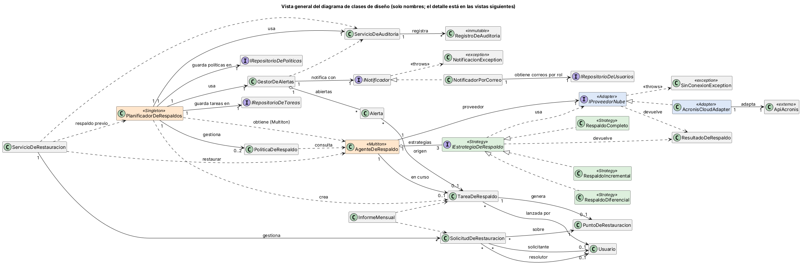
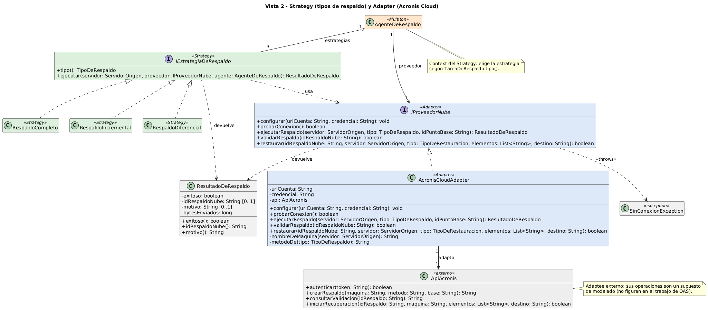
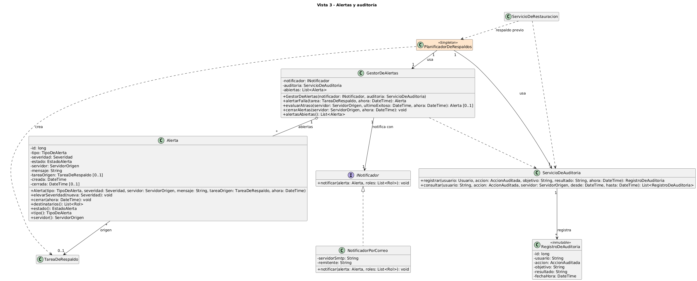
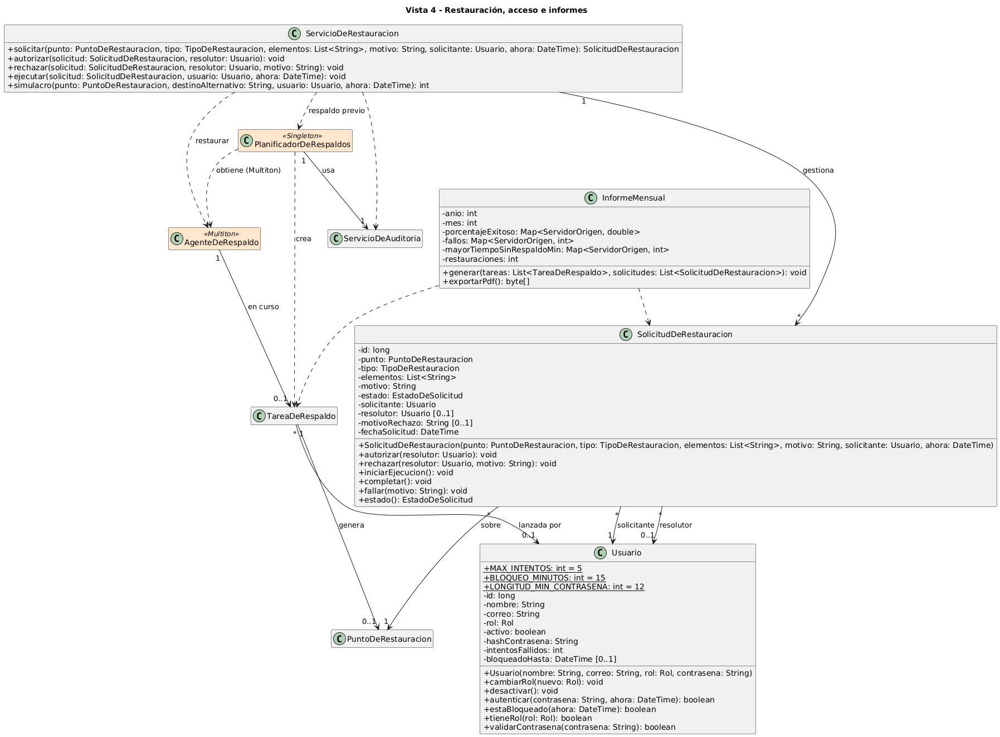
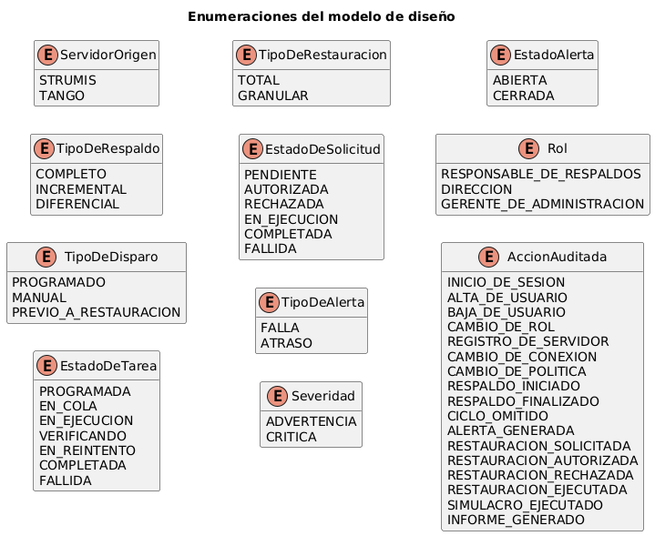

# 06 – Diseño de clases y patrones de diseño

| | |
|---|---|
| **Entregable** | Punto 6 de la consigna (Parcial 2) |
| **Estado** | Versión final – 30/10/2026 |
| **Base** | [00 – Documento maestro](00-documento-maestro.md) (nombres canónicos y reglas), [03 – Casos de uso](03-contexto-y-casos-de-uso.md) y [04 – Arquitectura](04-rnf-y-arquitectura.md) (componentes) |
| **Fuentes de los diagramas** | Un `.puml` por vista en [`diagramas/`](../diagramas/) (`06-clases-*.puml` y `06-enumeraciones.puml`) |

---

## 1. Cómo se lee el diseño

El diagrama de clases de diseño del SGR tiene **25 clases e interfaces y 11 enumeraciones**. Para que se pueda leer, se presenta en **una vista general** (solo nombres, con todas las asociaciones y sus multiplicidades) y **cuatro vistas de detalle** con atributos tipados y métodos con firma completa. Las seis imágenes son vistas de un mismo modelo y se generaron desde una sola definición, por lo que no se contradicen.

Convenciones: `[0..1]` indica un atributo o resultado opcional; los colores marcan los patrones (naranja: Singleton y Multiton; verde: Strategy; azul: Adapter; gris: sistema externo); los *getters* triviales que no se usan en los diagramas de estados y de secuencia se omiten; las asociaciones hacia enumeraciones no se dibujan (son atributos tipados). Los servicios de aplicación del documento 04 (*Servicio de Alertas*, *de Auditoría*, *de Restauración*) son las clases `GestorDeAlertas`, `ServicioDeAuditoria` y `ServicioDeRestauracion`.

### Vista general

Vista general: todas las clases, con sus asociaciones y multiplicidades.

Fuente: [`06-clases-vista-general.puml`](../diagramas/06-clases-vista-general.puml)

### Vista 1 – Núcleo de respaldo

Vista 1 – Núcleo de respaldo: `PlanificadorDeRespaldos` (Singleton) y `AgenteDeRespaldo` (Multiton).

Fuente: [`06-clases-nucleo.puml`](../diagramas/06-clases-nucleo.puml)

### Vista 2 – Strategy (tipos de respaldo) y Adapter (Acronis Cloud).

Vista 2 – Strategy (tipos de respaldo) y Adapter (Acronis Cloud).

Fuente: [`06-clases-strategy-adapter.puml`](../diagramas/06-clases-strategy-adapter.puml)

### Vista 3 – Alertas y auditoría.

Vista 3 – Alertas y auditoría.

Fuente: [`06-clases-alertas-auditoria.puml`](../diagramas/06-clases-alertas-auditoria.puml)

### Vista 4 – Restauración, acceso e informes.

Vista 4 – Restauración, acceso e informes.

Fuente: [`06-clases-restauracion-acceso.puml`](../diagramas/06-clases-restauracion-acceso.puml)

### Enumeraciones del modelo.

Enumeraciones del modelo.

Fuente: [`06-enumeraciones.puml`](../diagramas/06-enumeraciones.puml)

## 2. Catálogo de clases

| Clase | Tipo | Responsabilidad | Componente (doc. 04) | Historias | Casos de uso |
|---|---|---|---|---|---|
| `PlanificadorDeRespaldos` | Clase · **Singleton** | Decide cuándo se lanza cada respaldo, controla los reintentos y detecta atrasos. | Planificador | HU-003, 004, 005, 006, 007, 012, 016 | CU-03, 04, 06, 07, 08, 11, 14 |
| `AgenteDeRespaldo` | Clase · **Multiton** | Representa en el SGR al agente de Acronis de un servidor; ejecuta los respaldos y restauraciones y recuerda el último respaldo exitoso. | Gestor de Agentes | HU-001, 004, 007, 008, 009, 016 | CU-01, 04, 05, 14 |
| `PoliticaDeRespaldo` | Clase | Intervalo, hora del diferencial y retención de un servidor; elige el tipo de respaldo de cada ciclo. | Servicio de Políticas | HU-003, 004, 009 | CU-03, 04 |
| `TareaDeRespaldo` | Clase · entidad central | Una ejecución de respaldo con su estado, sus reintentos y su resultado. | Servicio de Respaldo | HU-004 a 010 | CU-04 a 09 |
| `PuntoDeRestauracion` | Clase | Respaldo verificado desde el cual se puede restaurar; vence según la retención. | Servicio de Respaldo | HU-008, 014 | CU-05, 12 |
| `ResultadoDeRespaldo` | Clase de valor | Resultado de un intento de respaldo en la nube (éxito, identificador y motivo). | Servicio de Respaldo | HU-004 | CU-04 |
| `IEstrategiaDeRespaldo` | Interfaz · **Strategy** | Contrato de los tres algoritmos de respaldo. | Servicio de Respaldo | HU-004 | CU-04 |
| `RespaldoCompleto` | Clase · Strategy concreta | Respaldo completo (sin punto base). | Servicio de Respaldo | HU-004 | CU-04 |
| `RespaldoIncremental` | Clase · Strategy concreta | Respaldo de los cambios desde el último respaldo. | Servicio de Respaldo | HU-004 | CU-04 |
| `RespaldoDiferencial` | Clase · Strategy concreta | Respaldo de los cambios desde el último completo. | Servicio de Respaldo | HU-004 | CU-04 |
| `IProveedorNube` | Interfaz · puerto · **Adapter** (Target) | Contrato que el dominio espera de cualquier proveedor de nube. | Puerto IProveedorNube | HU-002, 004, 008, 016, 017 | CU-02, 04, 05, 14, 15 |
| `AcronisCloudAdapter` | Clase · **Adapter** | Traduce el contrato del dominio a la API de Acronis. | Adaptador Acronis | HU-002, 004, 008, 016 | CU-02, 04, 05, 14 |
| `ApiAcronis` | Clase externa · Adaptee | API de Acronis (operaciones supuestas). | Acronis Cloud (externo) | HU-002, 004 | CU-02, 04 |
| `SinConexionException` | Excepción | Falta de conexión a Internet (RN-17). | Puerto IProveedorNube | HU-007 | CU-07 |
| `NotificacionException` | Excepción | Falla del envío de una notificación (por ejemplo, el correo); la alerta no se pierde (CA-3 de HU-011). | Puerto INotificador | HU-011, 013 | CU-10, 11 |
| `GestorDeAlertas` | Clase de servicio | Genera, eleva y cierra alertas y las notifica. | Servicio de Alertas | HU-011, 012, 013 | CU-10, 11 |
| `Alerta` | Clase | Aviso con tipo, severidad y estado; sabe a qué roles se notifica. | Servicio de Alertas | HU-011, 012, 013 | CU-10, 11 |
| `INotificador` | Interfaz · puerto | Contrato para enviar notificaciones. | Puerto INotificador | HU-011, 013 | CU-10, 11 |
| `NotificadorPorCorreo` | Clase | Envía las notificaciones por correo electrónico. | Notificador por Correo | HU-011, 013 | CU-10, 11 |
| `ServicioDeAuditoria` | Clase de servicio | Registra y consulta las acciones relevantes (RN-13). | Servicio de Auditoría | HU-020, 023 | CU-18, 20 |
| `RegistroDeAuditoria` | Clase · inmutable | Una acción registrada: quién, qué, cuándo y con qué resultado. | Servicio de Auditoría | HU-020, 023 | CU-18, 20 |
| `SolicitudDeRestauracion` | Clase | Pedido de restauración y su flujo de autorización. | Servicio de Restauración | HU-014, 015, 016 | CU-12, 13, 14 |
| `ServicioDeRestauracion` | Clase de servicio | Coordina solicitud, autorización, ejecución y simulacro. | Servicio de Restauración | HU-014 a 017 | CU-12 a 15 |
| `Usuario` | Clase | Persona que usa el SGR, con su rol y control de acceso. | Servicio de Acceso | HU-015, 018, 019, 022 | CU-16, 17 |
| `InformeMensual` | Clase | Informe mensual del estado de los respaldos. | Servicio de Informes | HU-021 | CU-19 |

**Enumeraciones:** `ServidorOrigen`, `TipoDeRespaldo`, `TipoDeDisparo`, `EstadoDeTarea`, `TipoDeRestauracion`, `EstadoDeSolicitud`, `TipoDeAlerta`, `Severidad`, `EstadoAlerta`, `Rol` y `AccionAuditada`. Sus valores son los del documento maestro (sección 12) y los usan los diagramas de estados.

## 3. Patrones de diseño

Se aplican **cuatro patrones**, de **tres categorías** distintas: Singleton y Multiton (creacionales), Adapter (estructural) y Strategy (de comportamiento). Singleton y Multiton son los patrones que le tocaron al grupo en el trabajo de la cursada (la presentación está en [`docs/Patrones Creacionales_ Singleton y Multiton (Modelacion) (2).pdf`](<Patrones Creacionales_ Singleton y Multiton (Modelacion) (2).pdf>)); el Multiton es una variante del Singleton y no figura entre los 23 patrones GoF, pero la cátedra lo asignó, por lo que se usa y se complementa con Adapter y Strategy.

### 3.1 Singleton – `PlanificadorDeRespaldos` *(creacional)*

**Problema del caso.** Tiene que haber **un solo** lugar que decida cuándo se lanza cada respaldo de STRUMIS y de TANGO. La regla RN-05 (un solo respaldo en ejecución por servidor) y el objetivo de pérdida máxima de datos (RNF-01) dependen de que los ciclos, los reintentos y las políticas estén coordinados.

**Roles.**

| Rol del patrón | Clase o elemento |
|---|---|
| Singleton | `PlanificadorDeRespaldos` |
| Instancia única | atributo estático `instancia` |
| Constructor restringido | `PlanificadorDeRespaldos()` privado |
| Punto de acceso global | `obtenerInstancia()` |
| Clientes | el reloj del sistema (`ejecutarCiclo`, `reintentar`), la interfaz de HU-006 (`lanzarRespaldoManual`) y `ServicioDeRestauracion` (`lanzarRespaldoPrevioARestauracion`) |

**Por qué este patrón y no otro.** Un *contenedor de inyección de dependencias* con alcance único daría la misma unicidad con menos acoplamiento, pero el SGR es un monolito pequeño (ADR-002) y no tiene contenedor. *Variables estáticas compartidas* (Monostate) comparten el estado, pero no impiden crear otro planificador con su propio reloj. Una *clase de utilidad estática* no puede tener ciclo de vida ni dependencias reemplazables. Singleton garantiza la unicidad con lo mínimo.

**Qué pasaría sin el patrón.** Si la interfaz y el arranque del servicio crearan cada uno su planificador, habría dos relojes y dos copias de las políticas: se lanzarían respaldos duplicados del mismo servidor (rompe RN-05), se generarían alertas por atraso duplicadas (RN-08) y los ciclos omitidos serían inconsistentes.

**Costos que se aceptan** (según el trabajo de la cursada): es estado global mutable y complica las pruebas unitarias. Se mitiga haciendo `obtenerInstancia()` seguro ante hilos y recibiendo `GestorDeAlertas` y `ServicioDeAuditoria` como atributos reemplazables en las pruebas.

### 3.2 Multiton – `AgenteDeRespaldo` *(creacional, variante del Singleton)*

**Problema del caso.** Hay **exactamente dos** servidores de origen, cada uno con su agente de Acronis (RN-02). HU-001 exige que no se pueda registrar dos veces el mismo servidor, y RN-05 se controla preguntándole al agente de ese servidor si ya hay un respaldo en curso. Además, cada agente recuerda el último respaldo exitoso y los puntos base, datos que usan HU-009, HU-012 y las estrategias.

**Roles.**

| Rol del patrón | Clase o elemento |
|---|---|
| Multiton | `AgenteDeRespaldo` |
| Clave | `ServidorOrigen` (`STRUMIS`, `TANGO`) |
| Registro de instancias | atributo estático `instancias: Map<ServidorOrigen, AgenteDeRespaldo>` |
| Acceso por clave | `obtenerInstancia(servidor)` y `existeInstancia(servidor)` |
| Clientes | `PlanificadorDeRespaldos`, `ServicioDeRestauracion` |

**Por qué este patrón y no otro.** Un *Singleton* no sirve: hacen falta **dos** instancias, una por clave. Dos clases `AgenteStrumis` y `AgenteTango` duplicarían el código y obligarían a modificarlo para sumar un servidor. Un *mapa suelto en el código cliente* no garantiza la unicidad. Es seguro usar Multiton porque las claves son **finitas** (la enumeración tiene 2 valores): no hay riesgo de fuga de memoria, el anti-patrón que advierte la presentación. Si algún día hubiera una sola clave posible, alcanzaría con un Singleton.

**Qué pasaría sin el patrón.** Dos partes del código podrían crear cada una su agente de TANGO, y cada uno creería estar libre: habría **dos respaldos simultáneos del mismo servidor** (rompe RN-05) y los datos de «último exitoso» quedarían desincronizados, lo que dispararía alertas de atraso falsas (RN-08).

### 3.3 Strategy – `IEstrategiaDeRespaldo` *(de comportamiento)*

**Problema del caso.** La regla RN-04 define tres tipos de respaldo (completo, incremental y diferencial) y la política elige cuál corresponde en cada ciclo (`tipoParaCiclo`). Cada tipo resuelve distinto el **punto base**: el completo no tiene; el incremental parte del último respaldo; el diferencial parte del último completo.

**Roles.**

| Rol del patrón | Clase o elemento |
|---|---|
| Strategy | `IEstrategiaDeRespaldo` |
| Estrategias concretas | `RespaldoCompleto`, `RespaldoIncremental`, `RespaldoDiferencial` |
| Contexto | `AgenteDeRespaldo` (guarda `estrategias` y elige según `TareaDeRespaldo.tipo()`) |
| Quien decide el tipo | `PoliticaDeRespaldo.tipoParaCiclo`, invocada por `PlanificadorDeRespaldos` |

**Por qué este patrón y no otro.** *Template Method* fija el algoritmo por herencia, pero acá el tipo cambia en **tiempo de ejecución**, ciclo a ciclo. *State* describe el ciclo de vida de `TareaDeRespaldo` (ver documento 07), no la elección de un algoritmo. Un simple *parámetro* `tipo` hacia Acronis bastaría si solo cambiara ese valor; se justifica Strategy porque también cambia la forma de resolver el punto base. **Riesgo a defender:** si Acronis resolviera el punto base por sí misma, bastaría el parámetro y Strategy sería sobreingeniería.

**Qué pasaría sin el patrón.** `AgenteDeRespaldo.ejecutarRespaldo` tendría un `if/else` por tipo: agregar un tipo obligaría a modificar esa clase y cada tipo sería difícil de probar por separado.

### 3.4 Adapter – `AcronisCloudAdapter` *(estructural)*

**Problema del caso.** El SGR debe hablar con Acronis Cloud, cuya API (`ApiAcronis`) usa su propio vocabulario (máquina, método, token) y no el del dominio (`ServidorOrigen`, `TipoDeRespaldo`). El ADR-001 y el ADR-002 piden concentrar ese acceso en un único punto.

**Roles.**

| Rol del patrón | Clase o elemento |
|---|---|
| Target (lo que el dominio espera) | `IProveedorNube` |
| Adapter | `AcronisCloudAdapter` (traduce con `nombreDeMaquina` y `metodoDe`) |
| Adaptee | `ApiAcronis` (externa; operaciones supuestas) |
| Clientes | `AgenteDeRespaldo`, las tres estrategias y `ServicioDeRestauracion` |

**Por qué este patrón y no otro.** Un *Facade* simplifica un subsistema complejo con una interfaz nueva; acá lo central es **convertir** una interfaz existente a la que el dominio ya espera y poder reemplazarla. *Bridge* separa abstracción e implementación para variar ambas, algo desproporcionado para un solo proveedor. Llamar a la API directamente esparciría su vocabulario por todo el dominio.

**Qué pasaría sin el patrón.** Las llamadas a Acronis quedarían repartidas entre el agente, las estrategias y la restauración: cualquier cambio de la API o de proveedor obligaría a tocar muchas clases (contra ADR-001), y las pruebas necesitarían una cuenta real de Acronis.

> **Nota sobre `INotificador` y `NotificadorPorCorreo`:** son un puerto y su adaptador de la arquitectura (ADR-002), no se cuentan como patrón GoF.

## 4. Dónde se aplican las reglas de negocio

| Regla | Dónde se aplica en el diseño |
|---|---|
| RN-03 | `PoliticaDeRespaldo` (`INTERVALO_MIN`, `INTERVALO_MAX`, `INTERVALO_POR_DEFECTO`, `validar`, `cumpleObjetivoDePerdida`) |
| RN-04 | `PoliticaDeRespaldo.tipoParaCiclo` y las tres estrategias |
| RN-05 | `AgenteDeRespaldo.hayRespaldoEnCurso`, consultado por `PlanificadorDeRespaldos.ejecutarCiclo` (si hay uno en curso, se registra `CICLO_OMITIDO`) |
| RN-06 | `TareaDeRespaldo.registrarFallo` y `MAX_REINTENTOS`; `PlanificadorDeRespaldos.reintentar` e `INTERVALO_ENTRE_REINTENTOS_MIN` |
| RN-07 | `AgenteDeRespaldo.ejecutarRespaldo` → `IProveedorNube.validarRespaldo` → `TareaDeRespaldo.completar` |
| RN-08 | `GestorDeAlertas` (`alertarFalla`, `evaluarAtraso`, `cerrarAlertas`); `Alerta` (`elevarSeveridad`, `cerrar`) |
| RN-09 | `Alerta.destinatarios` y `INotificador.notificar` |
| RN-10 | `SolicitudDeRestauracion.autorizar` (rol `DIRECCION`, distinto del solicitante) |
| RN-11 | `ServicioDeRestauracion.ejecutar` → `PlanificadorDeRespaldos.lanzarRespaldoPrevioARestauracion` (`TipoDeDisparo.PREVIO_A_RESTAURACION`) |
| RN-12 | `PoliticaDeRespaldo.retencionDias`; `PuntoDeRestauracion` (`vigenteHasta`, `estaVigente`) |
| RN-13 | `ServicioDeAuditoria.registrar`; `RegistroDeAuditoria`; `AccionAuditada`; `Usuario.SGR` (usuario de las acciones automáticas) |
| RN-14 | `ServicioDeRestauracion.simulacro` |
| RN-17 | `SinConexionException`; `TareaDeRespaldo.marcarEnCola`; `PlanificadorDeRespaldos.reanudarEnCola` |
| RN-18 | `Usuario` (`MAX_INTENTOS`, `BLOQUEO_MINUTOS`, `LONGITUD_MIN_CONTRASENA`, `autenticar`, `estaBloqueado`) |
| RN-19 | `PoliticaDeRespaldo` (constructor completo, `validar`, `errores`, constantes de intervalo y de retención); `PlanificadorDeRespaldos` (`definirPolitica`, `estaProtegido`) |
| RN-20 | `PoliticaDeRespaldo` (`INICIO_HORARIO_LABORAL`, `FIN_HORARIO_LABORAL`, `esHoraLaboral`) |
| RN-21 | `SolicitudDeRestauracion` (`validar`, `MOTIVO_MIN`, `MOTIVO_MAX`, `ELEMENTOS_MAX`, `ELEMENTO_LARGO_MAX`) |
| RN-22 | `ServicioDeRestauracion` (`puntosVigentes`, `contarPuntosVigentes`, `TAMANO_PAGINA`, `DIAS_RANGO_POR_DEFECTO`) |
| RN-23 | `AcronisCloudAdapter` (`TIEMPO_ESPERA_LLAMADA_SEG`, `TIEMPO_ESPERA_VALIDACION_SEG`) |

## 5. Trazabilidad historias de usuario ↔ clases

Toda historia tiene clases que la implementan y toda clase del catálogo aparece en alguna historia.

| Historia | Clases y métodos que la implementan |
|---|---|
| HU-001 | `AgenteDeRespaldo.obtenerInstancia` y `existeInstancia` (un agente por `ServidorOrigen`); `ServicioDeAuditoria.registrar` (`REGISTRO_DE_SERVIDOR`) |
| HU-002 | `IProveedorNube.configurar` y `probarConexion`; `AcronisCloudAdapter`; `ApiAcronis.autenticar` |
| HU-003 | `PoliticaDeRespaldo` (constructor completo, `validar`, `errores`, `esHoraLaboral`, `cumpleObjetivoDePerdida`); `PlanificadorDeRespaldos` (`definirPolitica(politica, usuario, ahora)`, `obtenerPolitica`, `estaProtegido`); `Usuario.tieneRol` |
| HU-004 | `PlanificadorDeRespaldos` (`ejecutarCiclo`, `lanzar`, `procesarResultado`); `AgenteDeRespaldo` (`ejecutarRespaldo`, `hayRespaldoEnCurso`); `PoliticaDeRespaldo.tipoParaCiclo`; `IEstrategiaDeRespaldo` y sus tres implementaciones; `AcronisCloudAdapter`; `TareaDeRespaldo`; `PuntoDeRestauracion` |
| HU-005 | `TareaDeRespaldo` (`registrarFallo`, `puedeReintentar`, `MAX_REINTENTOS`); `PlanificadorDeRespaldos.reintentar` |
| HU-006 | `PlanificadorDeRespaldos.lanzarRespaldoManual`; `TipoDeDisparo.MANUAL`; `ServicioDeAuditoria.registrar` |
| HU-007 | `TareaDeRespaldo.marcarEnCola`; `SinConexionException`; `PlanificadorDeRespaldos.reanudarEnCola` |
| HU-008 | `IProveedorNube.validarRespaldo`; `TareaDeRespaldo` (`marcarVerificando`, `completar`); `PuntoDeRestauracion` |
| HU-009 | `AgenteDeRespaldo.ultimoExitoso`; `PoliticaDeRespaldo.proximaEjecucion`; `TareaDeRespaldo.estado`; `GestorDeAlertas.alertasAbiertas` |
| HU-010 | `TareaDeRespaldo` (servidor, estado y fechas, consultados con filtros) |
| HU-011 | `GestorDeAlertas.alertarFalla`; `Alerta` (`correoEnviado`, `marcarCorreoFallido`); `INotificador` y `NotificadorPorCorreo`; `NotificacionException` |
| HU-012 | `PlanificadorDeRespaldos.detectarAtrasos`; `GestorDeAlertas.evaluarAtraso`; `Alerta` (`elevarSeveridad`, `cerrar`) |
| HU-013 | `Alerta.destinatarios`; `INotificador.notificar`; `NotificacionException` |
| HU-014 | `ServicioDeRestauracion` (`solicitar`, `puntosVigentes`, `contarPuntosVigentes`); `SolicitudDeRestauracion` (`validar`); `PuntoDeRestauracion.estaVigente`; `Usuario.tieneRol` |
| HU-015 | `ServicioDeRestauracion` (`autorizar`, `rechazar`); `SolicitudDeRestauracion` (`autorizar`, `rechazar`); `Usuario.tieneRol` |
| HU-016 | `ServicioDeRestauracion.ejecutar`; `PlanificadorDeRespaldos.lanzarRespaldoPrevioARestauracion`; `AgenteDeRespaldo.restaurar`; `IProveedorNube.restaurar`; `SolicitudDeRestauracion` (`iniciarEjecucion`, `completar`, `fallar`) |
| HU-017 | `ServicioDeRestauracion.simulacro`; `IProveedorNube.restaurar` |
| HU-018 | `Usuario` (`autenticar`, `estaBloqueado`, `validarContrasena`, `tieneRol`); `Rol` |
| HU-019 | `Usuario` (constructor, `cambiarRol`, `desactivar`) |
| HU-020 | `ServicioDeAuditoria.consultar`; `RegistroDeAuditoria` |
| HU-021 | `InformeMensual` (`generar`, `exportarPdf`) |
| HU-022 | `Usuario.tieneRol` (rol `GERENTE_DE_ADMINISTRACION`); consulta de `TareaDeRespaldo` filtrada por `TANGO` |
| HU-023 | `ServicioDeAuditoria.registrar`; `RegistroDeAuditoria`; `AccionAuditada` |

## 6. Decisiones y supuestos de este diseño

- **`ApiAcronis` es un supuesto.** El trabajo de OAS no describe la API de Acronis; sus operaciones se definieron para poder modelar el Adapter y deben contrastarse con la documentación real del producto.
- **El respaldo previo a una restauración** (RN-11) es una tarea más, con disparador `PREVIO_A_RESTAURACION`; se ejecuta con el mismo flujo que un respaldo programado (CU-14 incluye a CU-04).
- **Un reintento vuelve a ejecutar el respaldo completo** de esa tarea; `TareaDeRespaldo.registrarFallo` cuenta los reintentos y deja la tarea en `EN_REINTENTO` hasta `MAX_REINTENTOS` (3); con 3 reintentos hay 4 intentos en total.
- **Las operaciones de lectura** (panel, historial, informe) no se dibujan como métodos propios: consultan los atributos de `TareaDeRespaldo`, `Alerta` y `AgenteDeRespaldo`.
- **Las tareas no se cancelan:** ninguna historia ni caso de uso lo pide, por eso `EstadoDeTarea` no incluye un estado de cancelación.

## 7. Relación con el trabajo de patrones de la cursada

Los ejemplos de la presentación (generador global de identificadores y configuración regional por país en un comercio electrónico) y los de este documento comparten la estructura, pero resuelven problemas distintos: allá, evitar identificadores duplicados y configuraciones inconsistentes; acá, evitar respaldos simultáneos sobre el mismo servidor y coordinar los ciclos. De la presentación se reutilizan los criterios: el patrón exige constructor restringido y punto de acceso, el Multiton solo es seguro con claves finitas, y ambos tienen el costo de estado global que complica las pruebas.
