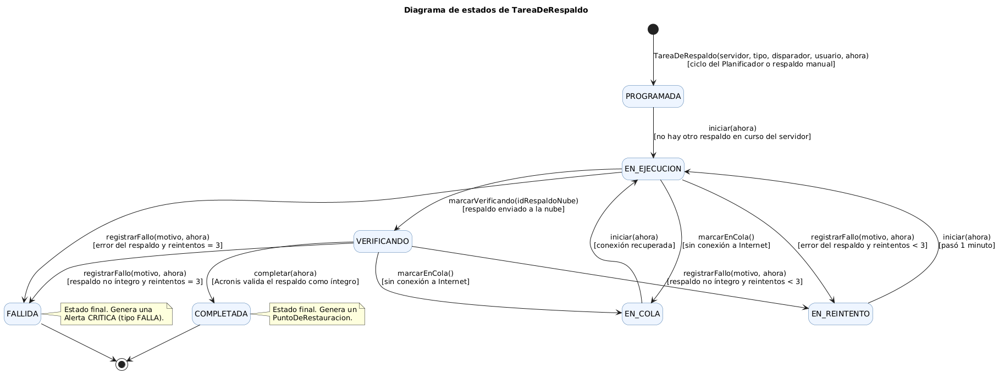
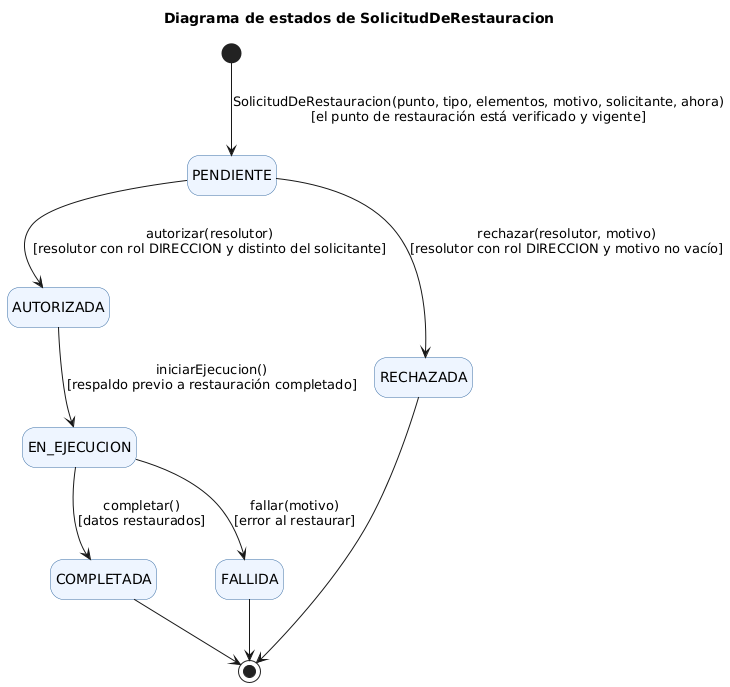
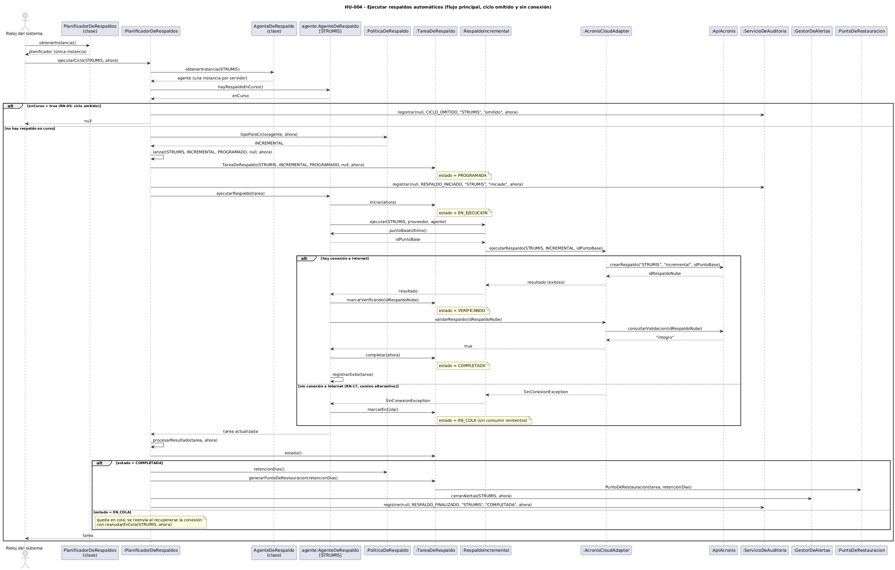
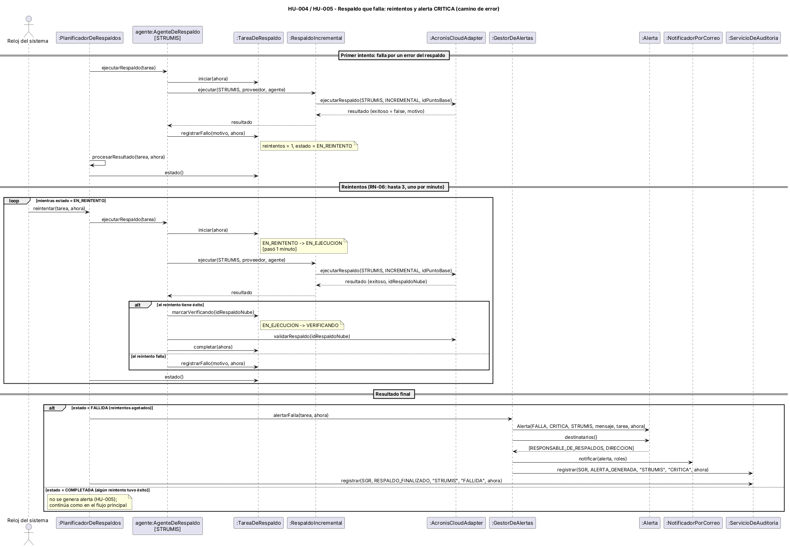

# 07 – Diagramas de estados y de secuencia

| | |
|---|---|
| **Entregable** | Punto 7 de la consigna (Parcial 2) |
| **Estado** | Versión final – 30/10/2026 |
| **Base** | [06 – Diseño de clases](06-diseno-de-clases.md) y [00 – Documento maestro](00-documento-maestro.md) (estados y reglas) |
| **Fuentes de los diagramas** | [`07-estados-tarea.puml`](../diagramas/07-estados-tarea.puml), [`07-estados-solicitud.puml`](../diagramas/07-estados-solicitud.puml), [`07-secuencia-hu004.puml`](../diagramas/07-secuencia-hu004.puml) y [`07-secuencia-hu004-error.puml`](../diagramas/07-secuencia-hu004-error.puml) |

---

## 1. Diagrama de estados de la entidad central: `TareaDeRespaldo`

`TareaDeRespaldo` es la entidad central del caso: toda la operación del SGR (respaldos programados, manuales y previos a una restauración) pasa por una tarea. Sus estados son los de `EstadoDeTarea` (documento maestro, sección 12).

### Transiciones

Cada evento es un **método de `TareaDeRespaldo`** del diagrama de clases (vista 1).

| Origen | Destino | Evento (método) | Condición | Regla | Historias |
|---|---|---|---|---|---|
| (inicio) | PROGRAMADA | `TareaDeRespaldo(servidor, tipo, disparador, usuario, ahora)` | ciclo del Planificador o respaldo manual | RN-05 | HU-004, HU-006 |
| PROGRAMADA | EN_EJECUCION | `iniciar(ahora)` | no hay otro respaldo en curso del servidor | RN-05 | HU-004 |
| EN_EJECUCION | VERIFICANDO | `marcarVerificando(idRespaldoNube)` | respaldo enviado a la nube | RN-07 | HU-004, HU-008 |
| VERIFICANDO | COMPLETADA | `completar(ahora)` | Acronis valida el respaldo como íntegro | RN-07 | HU-008 |
| EN_EJECUCION | EN_COLA | `marcarEnCola()` | sin conexión a Internet | RN-17 | HU-007 |
| VERIFICANDO | EN_COLA | `marcarEnCola()` | sin conexión a Internet | RN-17 | HU-007 |
| EN_COLA | EN_EJECUCION | `iniciar(ahora)` | conexión recuperada | RN-17 | HU-007 |
| EN_EJECUCION | EN_REINTENTO | `registrarFallo(motivo, ahora)` | error del respaldo y reintentos < 3 | RN-06 | HU-005 |
| VERIFICANDO | EN_REINTENTO | `registrarFallo(motivo, ahora)` | respaldo no íntegro y reintentos < 3 | RN-06, RN-07 | HU-005, HU-008 |
| EN_REINTENTO | EN_EJECUCION | `iniciar(ahora)` | pasó 1 minuto | RN-06 | HU-005 |
| EN_EJECUCION | FALLIDA | `registrarFallo(motivo, ahora)` | error del respaldo y reintentos = 3 | RN-06 | HU-005, HU-011 |
| VERIFICANDO | FALLIDA | `registrarFallo(motivo, ahora)` | respaldo no íntegro y reintentos = 3 | RN-06, RN-07 | HU-005, HU-011 |
| COMPLETADA | (fin) | — | estado final: genera un `PuntoDeRestauracion` | RN-07, RN-12 | HU-008 |
| FALLIDA | (fin) | — | estado final: genera una `Alerta` CRITICA (tipo FALLA) | RN-08 | HU-011 |

**Estados finales:** `COMPLETADA` y `FALLIDA`. Una tarea final no cambia más; un nuevo ciclo crea otra tarea.

**Cómo se cuentan los reintentos.** `registrarFallo` lleva la tarea a `EN_REINTENTO` mientras `reintentos < MAX_REINTENTOS` (3) y a `FALLIDA` cuando ya se usaron los 3. Como cada reintento vuelve a ejecutar el respaldo, una tarea que nunca tiene éxito hace **4 intentos** en total, separados por 1 minuto (unos 3 minutos desde el primer fallo, menos que el intervalo mínimo de 5 minutos; SM-05).

**Falta de conexión.** Pasar a `EN_COLA` **no** consume reintentos (RN-17): la tarea espera hasta que `PlanificadorDeRespaldos.reanudarEnCola` la vuelve a lanzar.

**Un respaldo no íntegro** (`VERIFICANDO`) se trata como cualquier error del respaldo: se reintenta y recién tras agotar los reintentos queda `FALLIDA`. En ningún caso genera un `PuntoDeRestauracion` (RN-07).

## 2. Diagrama de estados de `SolicitudDeRestauracion`

Se agrega este segundo diagrama porque el flujo de autorización (RN-10) también tiene un ciclo de vida propio.

| Origen | Destino | Evento (método) | Condición | Regla | Historias |
|---|---|---|---|---|---|
| (inicio) | PENDIENTE | `SolicitudDeRestauracion(punto, tipo, elementos, motivo, solicitante, ahora)` | el punto de restauración está verificado y vigente | RN-10, RN-12 | HU-014 |
| PENDIENTE | AUTORIZADA | `autorizar(resolutor)` | resolutor con rol `DIRECCION` y distinto del solicitante | RN-10 | HU-015 |
| PENDIENTE | RECHAZADA | `rechazar(resolutor, motivo)` | resolutor con rol `DIRECCION` y motivo no vacío | RN-10 | HU-015 |
| AUTORIZADA | EN_EJECUCION | `iniciarEjecucion()` | respaldo previo a restauración completado | RN-11 | HU-016 |
| EN_EJECUCION | COMPLETADA | `completar()` | datos restaurados | — | HU-016 |
| EN_EJECUCION | FALLIDA | `fallar(motivo)` | error al restaurar (alerta CRITICA) | RN-08 | HU-016 |
| RECHAZADA, COMPLETADA, FALLIDA | (fin) | — | estados finales | — | — |

## 3. Diagramas de secuencia de la HU-004

### Por qué la HU-004

Se modela **HU-004 – Ejecutar respaldos automáticos según la política** porque es la que más participantes del diseño recorre: usa los patrones **Singleton** (`PlanificadorDeRespaldos`), **Multiton** (`AgenteDeRespaldo`), **Strategy** (`RespaldoIncremental`) y **Adapter** (`AcronisCloudAdapter`), y tiene caminos alternativos y de error reales. Es una de las cuatro historias del punto 8 (HU-003, HU-004, HU-011 y HU-014), que se desarrollan en [`docs/historias/`](historias/).

### 3.1 Flujo principal, ciclo omitido y sin conexión

**Lectura del diagrama.**

1. El reloj del sistema obtiene el único `PlanificadorDeRespaldos` (`obtenerInstancia`) y le indica que ejecute el ciclo de STRUMIS.
2. El planificador obtiene el `AgenteDeRespaldo` del servidor (`obtenerInstancia(STRUMIS)`, Multiton) y le pregunta si hay un respaldo en curso (RN-05).
3. **Camino alternativo 1 – ciclo omitido:** si hay uno en curso, registra `CICLO_OMITIDO` en la auditoría y termina.
4. Si no, `PoliticaDeRespaldo.tipoParaCiclo` indica el tipo (acá, `INCREMENTAL`), se crea la `TareaDeRespaldo` en `PROGRAMADA` y se audita `RESPALDO_INICIADO`.
5. El agente pone la tarea `EN_EJECUCION` y delega en la estrategia `RespaldoIncremental`, que obtiene el punto base del agente y pide el respaldo a `AcronisCloudAdapter`, el cual llama a `ApiAcronis`.
6. **Camino alternativo 2 – sin conexión:** si no hay Internet, el adaptador lanza `SinConexionException` y la tarea pasa a `EN_COLA` (RN-17).
7. Si hay conexión, la tarea pasa a `VERIFICANDO`, Acronis valida el respaldo, la tarea pasa a `COMPLETADA` y el agente registra el éxito.
8. El planificador procesa el resultado: si está `COMPLETADA`, genera el `PuntoDeRestauracion` (con la retención de la política), cierra las alertas abiertas del servidor y audita `RESPALDO_FINALIZADO`.

**Mensajes y métodos usados** (todos existen en el diagrama de clases):

| Clase | Método | ¿Existe en el diagrama de clases? |
|---|---|---|
| `AcronisCloudAdapter` | `ejecutarRespaldo` | Sí |
| `AcronisCloudAdapter` | `validarRespaldo` | Sí |
| `AgenteDeRespaldo` | `ejecutarRespaldo` | Sí |
| `AgenteDeRespaldo` | `hayRespaldoEnCurso` | Sí |
| `AgenteDeRespaldo` | `obtenerInstancia` | Sí |
| `AgenteDeRespaldo` | `puntoBaseUltimo` | Sí |
| `AgenteDeRespaldo` | `registrarExito` | Sí |
| `ApiAcronis` | `consultarValidacion` | Sí |
| `ApiAcronis` | `crearRespaldo` | Sí |
| `GestorDeAlertas` | `cerrarAlertas` | Sí |
| `PlanificadorDeRespaldos` | `ejecutarCiclo` | Sí |
| `PlanificadorDeRespaldos` | `lanzar` | Sí |
| `PlanificadorDeRespaldos` | `obtenerInstancia` | Sí |
| `PlanificadorDeRespaldos` | `procesarResultado` | Sí |
| `PoliticaDeRespaldo` | `retencionDias` | Sí |
| `PoliticaDeRespaldo` | `tipoParaCiclo` | Sí |
| `PuntoDeRestauracion` | `PuntoDeRestauracion` | Sí |
| `RespaldoIncremental` | `ejecutar` | Sí |
| `ServicioDeAuditoria` | `registrar` | Sí |
| `TareaDeRespaldo` | `TareaDeRespaldo` | Sí |
| `TareaDeRespaldo` | `completar` | Sí |
| `TareaDeRespaldo` | `estado` | Sí |
| `TareaDeRespaldo` | `generarPuntoDeRestauracion` | Sí |
| `TareaDeRespaldo` | `iniciar` | Sí |
| `TareaDeRespaldo` | `marcarEnCola` | Sí |
| `TareaDeRespaldo` | `marcarVerificando` | Sí |

### 3.2 Camino de error: reintentos y alerta CRITICA

**Lectura del diagrama.**

1. El primer intento falla por un error del respaldo: `registrarFallo` deja la tarea en `EN_REINTENTO`.
2. Mientras la tarea esté `EN_REINTENTO`, el reloj invoca `reintentar` una vez por minuto; cada reintento vuelve a llamar a `iniciar` (EN_REINTENTO → EN_EJECUCION) y a ejecutar la estrategia y el adaptador; si tiene éxito, `marcarVerificando` lleva la tarea a VERIFICANDO, recorre la verificación y llega a `COMPLETADA` **sin generar alerta** (HU-005).
3. Si los 3 reintentos fallan, la tarea queda `FALLIDA`: `GestorDeAlertas.alertarFalla` crea una `Alerta` (tipo `FALLA`, severidad `CRITICA`), `Alerta.destinatarios` indica `RESPONSABLE_DE_RESPALDOS` y `DIRECCION`, y `NotificadorPorCorreo` la envía (HU-011 y HU-013). Se auditan `ALERTA_GENERADA` y `RESPALDO_FINALIZADO`. Todas las acciones automáticas se registran con el usuario de sistema `Usuario.SGR` (RN-13); en la tarea programada, `usuario` = nulo solo indica que no la lanzó una persona.

**Mensajes y métodos usados:**

| Clase | Método | ¿Existe en el diagrama de clases? |
|---|---|---|
| `AcronisCloudAdapter` | `ejecutarRespaldo` | Sí |
| `AcronisCloudAdapter` | `validarRespaldo` | Sí |
| `AgenteDeRespaldo` | `ejecutarRespaldo` | Sí |
| `Alerta` | `Alerta` | Sí |
| `Alerta` | `destinatarios` | Sí |
| `GestorDeAlertas` | `alertarFalla` | Sí |
| `NotificadorPorCorreo` | `notificar` | Sí |
| `PlanificadorDeRespaldos` | `procesarResultado` | Sí |
| `PlanificadorDeRespaldos` | `reintentar` | Sí |
| `RespaldoIncremental` | `ejecutar` | Sí |
| `ServicioDeAuditoria` | `registrar` | Sí |
| `TareaDeRespaldo` | `completar` | Sí |
| `TareaDeRespaldo` | `estado` | Sí |
| `TareaDeRespaldo` | `iniciar` | Sí |
| `TareaDeRespaldo` | `marcarVerificando` | Sí |
| `TareaDeRespaldo` | `registrarFallo` | Sí |

## 4. Coherencia con los demás documentos

- **Estados:** los de los dos diagramas son los de `EstadoDeTarea` y `EstadoDeSolicitud`, iguales a los del documento maestro.
- **Eventos:** cada transición es un método de `TareaDeRespaldo` o `SolicitudDeRestauracion` del diagrama de clases.
- **Mensajes:** cada mensaje de las secuencias es un método existente en el diagrama de clases, con los mismos nombres de clases y de métodos.
- **Reglas:** RN-05, RN-06, RN-07, RN-11 y RN-17 están reflejadas en las transiciones y en los caminos alternativos.
