# 10 – Prototipo de pantallas y evaluación heurística

| | |
|---|---|
| **Entregable** | Punto 10 de la consigna (Parcial 3) |
| **Estado** | Versión final – 30/10/2026 |
| **Base** | Historias de [`docs/historias/`](historias/) y [06 – Diseño de clases](06-diseno-de-clases.md) |
| **Capturas** | Carpeta [`prototipo/`](../prototipo/) (imágenes `.png`) |
| **Fuentes del prototipo** | [`prototipo/fuentes/`](../prototipo/fuentes/) (archivos `.puml` de PlantUML Salt) |

---

## 1. Herramienta y alcance

Los prototipos son de **media fidelidad** y se hicieron con **PlantUML Salt**, una herramienta libre que dibuja maquetas de pantallas a partir de texto. Por eso el «link al prototipo» es la carpeta `prototipo/fuentes/` del repositorio, no un enlace a Figma o Penpot. Si la cátedra exige uno de esos programas, las pantallas se pueden rehacer en minutos tomando estas capturas como modelo.

Se prototiparon **las pantallas de las 4 historias del punto 8**: HU-003, HU-004, HU-011 y HU-014. Cada una tiene al menos 2 pantallas finales, una de ellas con un estado de error o un mensaje de validación, y una captura «antes» de la versión inicial que se corrigió.

## 2. Reglas usadas y escala de severidad

Se usaron las **heurísticas de Nielsen**, que forman parte de las 21 reglas de la cátedra (Shneiderman, Nielsen y Pierotti). Cada regla se cita por su nombre y por su código N1 a N10 de Nielsen.

| Código | Regla (fuente) |
|---|---|
| N1 | Visibilidad del estado del sistema (Nielsen) |
| N2 | Correspondencia entre el sistema y el mundo real (Nielsen) |
| N3 | Control y libertad del usuario (Nielsen) |
| N4 | Consistencia y estándares (Nielsen) |
| N5 | Prevención de errores (Nielsen) |
| N6 | Reconocer en lugar de recordar (Nielsen) |
| N7 | Flexibilidad y eficiencia de uso (Nielsen) |
| N9 | Ayudar a reconocer, diagnosticar y recuperarse de los errores (Nielsen) |

**Severidad (escala de 0 a 4):**

| Severidad | Significado |
|---|---|
| 0 | No es un problema de usabilidad |
| 1 | Problema cosmético: se corrige si hay tiempo |
| 2 | Problema menor: baja prioridad |
| 3 | Problema mayor: importante corregirlo |
| 4 | Catastrófico: hay que corregirlo antes de entregar |

## HU-003 – Definir la política de respaldo de cada servidor

### Prototipo

**Pantalla 1 – Política de respaldo (formulario)**

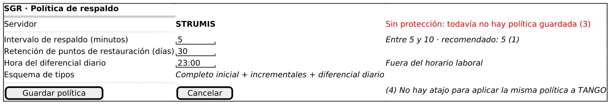

**Pantalla 2 – Error de validación del intervalo**

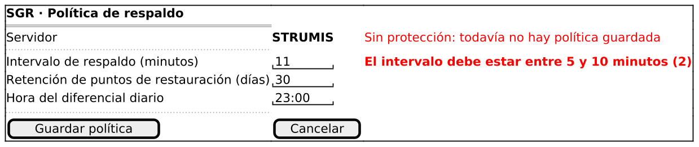

### Evaluación heurística

| Regla | Pantalla | ¿Cumple? | Evidencia (marca señalada en la captura) | Severidad |
|---|---|---|---|---|
| N5 – Prevención de errores | Pantalla 1 | No cumplía → cumple | Marca (1): el intervalo muestra el rango «entre 5 y 10» y el valor recomendado 5; en la versión anterior era un campo libre sin indicación. | 3 → 0 |
| N9 – Ayudar a reconocer, diagnosticar y recuperarse de los errores | Pantalla 2 | No cumplía → cumple | Marca (2): el mensaje está junto al campo y dice el rango válido; antes un cartel genérico decía «Error: valor inválido». | 3 → 0 |
| N1 – Visibilidad del estado del sistema | Pantalla 1 | Cumple | Marca (3): la etiqueta «Sin protección» informa que el servidor aún no tiene política. | 0 |
| N7 – Flexibilidad y eficiencia de uso | Pantalla 1 | No cumple | Marca (4): hay que definir la política servidor por servidor; no existe un atajo para aplicar la misma a ambos. | 1 |

Las severidades con flecha indican el valor **antes → después** de la corrección.

### Corrección aplicada: antes y después

**Problema encontrado:** Cartel genérico «Error: valor inválido» arriba, sin decir qué campo ni qué rango; el intervalo era un campo libre sin indicación.

**Corrección:** Mensaje junto al campo con el rango válido (5 a 10) y el valor recomendado visible.

| Antes | Después |
|---|---|
| 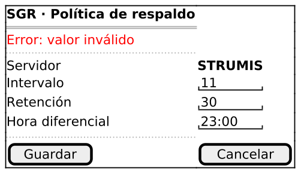 |  |

**Problemas que quedan abiertos:** N7 (Problema menor aceptado; queda fuera del alcance de la historia.)

## HU-004 – Ejecutar respaldos automáticos según la política

### Prototipo

**Pantalla 1 – Panel de respaldos**

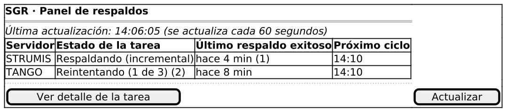

**Pantalla 2 – Detalle de una tarea con error y reintento**

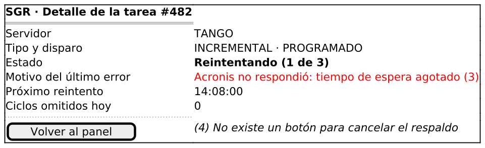

### Evaluación heurística

| Regla | Pantalla | ¿Cumple? | Evidencia (marca señalada en la captura) | Severidad |
|---|---|---|---|---|
| N1 – Visibilidad del estado del sistema | Pantalla 1 | No cumplía → cumple | Marca (1): se muestra «hace 4 min» y la hora del próximo ciclo; antes solo se veía el estado. | 3 → 0 |
| N2 – Correspondencia entre el sistema y el mundo real | Pantalla 1 | No cumplía → cumple | Marca (2): «Reintentando (1 de 3)» reemplaza al código interno EN_REINTENTO. | 3 → 0 |
| N9 – Ayudar a reconocer, diagnosticar y recuperarse de los errores | Pantalla 2 | Cumple | Marca (3): el motivo del error está en lenguaje claro e indica cuándo será el próximo reintento. | 0 |
| N3 – Control y libertad del usuario | Pantalla 2 | No cumple | Marca (4): no hay un botón para cancelar un respaldo en curso; es una decisión del diseño (no existe esa operación). | 1 |

Las severidades con flecha indican el valor **antes → después** de la corrección.

### Corrección aplicada: antes y después

**Problema encontrado:** El panel mostraba códigos internos (EN_EJECUCION, EN_REINTENTO) sin tiempos.

**Corrección:** Estados en lenguaje claro, «último respaldo exitoso: hace N min» y hora del próximo ciclo.

| Antes | Después |
|---|---|
| 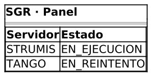 |  |

**Problemas que quedan abiertos:** N3 (Aceptado: ninguna historia pide cancelar respaldos.)

## HU-011 – Recibir una alerta cuando un respaldo falla

### Prototipo

**Pantalla 1 – Panel de alertas**

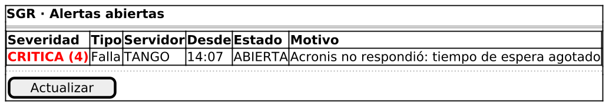

**Pantalla 2 – Correo de alerta**

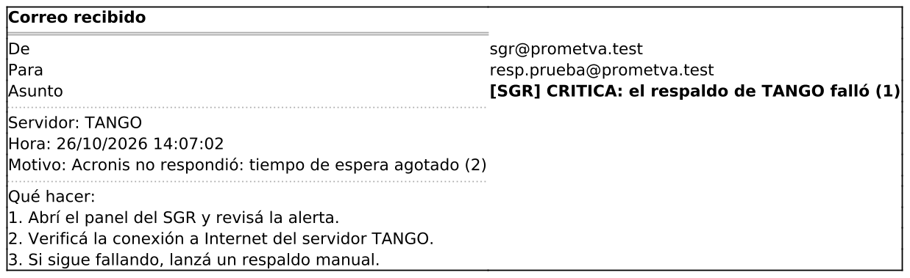

**Pantalla 3 – Alerta cuando el correo falla**

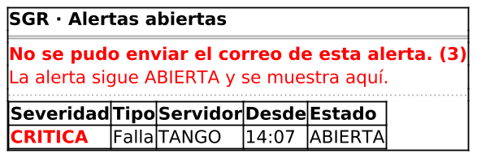

### Evaluación heurística

| Regla | Pantalla | ¿Cumple? | Evidencia (marca señalada en la captura) | Severidad |
|---|---|---|---|---|
| N2 – Correspondencia entre el sistema y el mundo real | Pantalla 2 | No cumplía → cumple | Marca (1): el asunto dice «[SGR] CRITICA: el respaldo de TANGO falló»; antes decía solo «Alerta #A-17». | 3 → 0 |
| N9 – Ayudar a reconocer, diagnosticar y recuperarse de los errores | Pantalla 2 | No cumplía → cumple | Marca (2): el correo indica el motivo y qué hacer; antes solo decía «Se generó una alerta». | 3 → 0 |
| N1 – Visibilidad del estado del sistema | Pantalla 3 | Cumple | Marca (3): si el correo falla, el panel lo avisa y aclara que la alerta sigue ABIERTA. | 0 |
| N4 – Consistencia y estándares | Pantalla 1 | Cumple | Marca (4): la severidad se muestra con texto («CRITICA») además del color. | 0 |

Las severidades con flecha indican el valor **antes → después** de la corrección.

### Corrección aplicada: antes y después

**Problema encontrado:** Asunto «Alerta #A-17» y cuerpo «Se generó una alerta», sin servidor, hora, motivo ni acción sugerida.

**Corrección:** Asunto que dice la severidad y el servidor, con motivo, hora y pasos a seguir.

| Antes | Después |
|---|---|
| 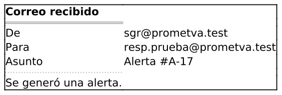 |  |

## HU-014 – Solicitar una restauración

### Prototipo

**Pantalla 1 – Nueva solicitud de restauración**

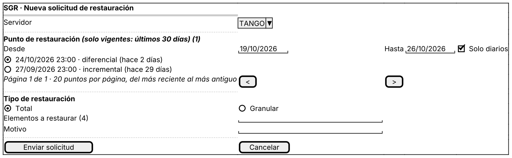

**Pantalla 2 – Errores de validación**

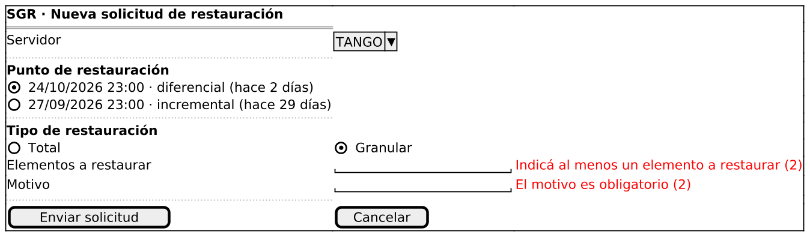

**Pantalla 3 – Solicitud enviada (PENDIENTE)**

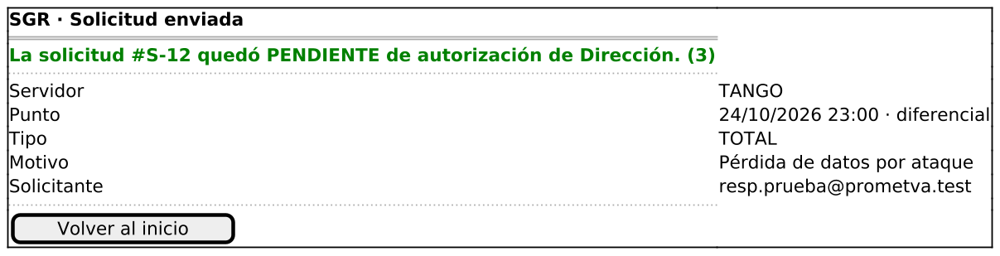

**Pantalla 4 – Servidor sin puntos vigentes (estado vacío, CA-7)**

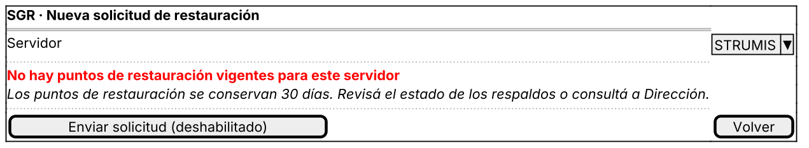

### Evaluación heurística

| Regla | Pantalla | ¿Cumple? | Evidencia (marca señalada en la captura) | Severidad |
|---|---|---|---|---|
| N5 – Prevención de errores | Pantalla 1 | No cumplía → cumple | Marca (1): solo se ofrecen puntos vigentes y hay un resumen antes de enviar; antes se listaban también los vencidos. | 3 → 0 |
| N9 – Ayudar a reconocer, diagnosticar y recuperarse de los errores | Pantalla 2 | Cumple | Marca (2): cada mensaje de error está junto al campo y dice cómo resolverlo. | 0 |
| N1 – Visibilidad del estado del sistema | Pantalla 3 | Cumple | Marca (3): se confirma que la solicitud quedó PENDIENTE de autorización y con qué número. | 0 |
| N6 – Reconocer en lugar de recordar | Pantalla 1 | No cumple | Marca (4): para una restauración granular hay que escribir los elementos de memoria; no hay una lista para elegir. | 2 |

Las severidades con flecha indican el valor **antes → después** de la corrección.

### Corrección aplicada: antes y después

**Problema encontrado:** La lista incluía puntos vencidos (hace 31 días) y se enviaba sin resumen ni indicación de vigencia.

**Corrección:** Solo puntos vigentes, aclaración «últimos 30 días» y confirmación posterior del estado PENDIENTE.

| Antes | Después |
|---|---|
| 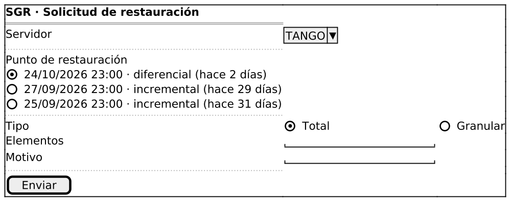 |  |

**Problemas que quedan abiertos:** N6 (Mejora futura: ofrecer la lista de tablas o carpetas del punto elegido.)

## Resumen

| Historia | Pantallas finales | Evaluaciones | Correcciones aplicadas | Problemas abiertos |
|---|---|---|---|---|
| HU-003 | 2 | 4 | 2 | 1 |
| HU-004 | 2 | 4 | 2 | 1 |
| HU-011 | 3 | 4 | 2 | 0 |
| HU-014 | 4 | 4 | 1 | 1 |
